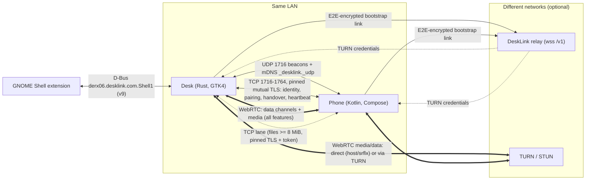
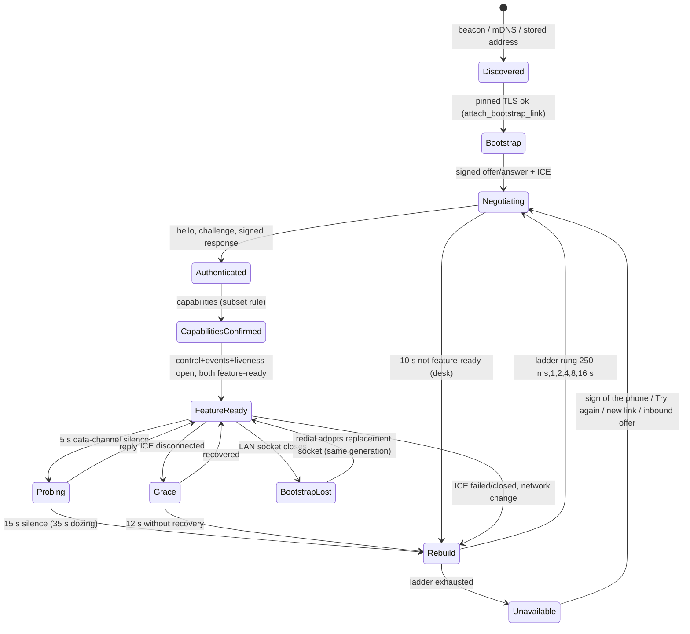
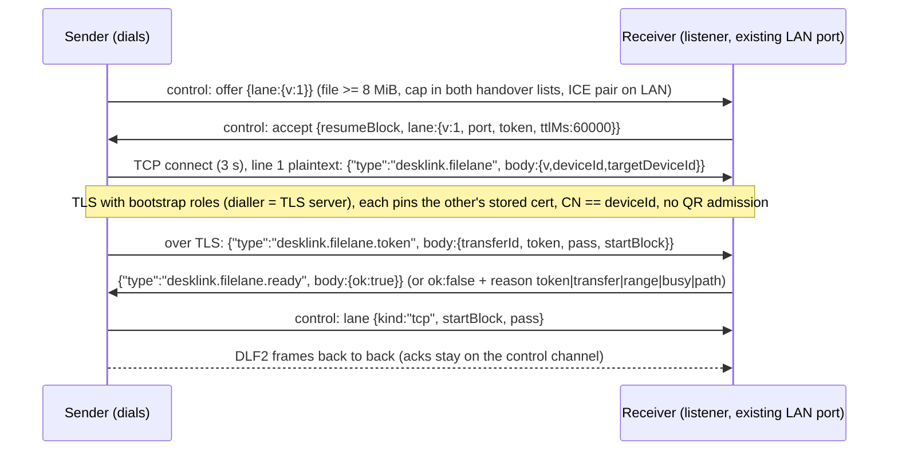

# DeskLink 1.3 technical architecture

Status: written 2026-11-06 from the code on the checked-out trees (desk `DeskLink/` branch `webrtc-stabilisation` at `2a07423`; phone `desklink-mobile/` branch `webrtc-stabilisation` at `255c8da`) and the workspace documents (`CLAUDE.md`, `docs/WEBRTC.md`, `docs/RELAY.md`, `docs/PAIRING-OFF-LAN.md`, `docs/LINUX-SUPPORT.md`, `docs/TERMINALS-MOBILE.md`, `docs/UI-REDESIGN.md`, `docs/FEATURE-STATUS.md`, `docs/IDENTIFIER_COMPATIBILITY.md`, `docs/protocol/stageD-protocol.md`). No build or test was run to write it. Where a document and the code disagree, the code is described and the disagreement is listed in section 15.5. Citations are `path:line` (line numbers drift; treat them as pointers). Desktop paths are under `DeskLink/src/`, phone paths under `desklink-mobile/src/main/java/org/desklink/mobile/`, unless a path starts with `docs/`, `protocol/` or `tools/` (workspace root).

Contents: 1 Product and goals; 2 System context; 3 Repo and module map; 4 Identity, pairing and trust; 5 Link lifecycle; 6 Data channels and envelopes; 7 Feature layer; 8 File transfer v2 and bulk lanes; 9 Screen media and the latency contract; 10 Terminals; 11 UI architecture; 12 Security model; 13 Build, test and release; 14 Linux support; 15 Limits, decisions, extending, inconsistencies; Glossary.

## 1. Product and goals

DeskLink is one product in two apps: a Rust + GTK4/libadwaita desktop client for Linux (`DeskLink/`, crate `desklink` 1.3.0, `DeskLink/Cargo.toml`) and a Kotlin/Java Android app (`desklink-mobile/`, package `org.desklink.mobile`, versionName `1.3.0`, versionCode `20300`, `minSdk 24`, `targetSdk 36`, `desklink-mobile/build.gradle.kts:35-42`). A phone and a computer pair once by scanning a QR code, then use each other: shared clipboard, phone notifications on the desk, notes and snippets, contacts, a shared "Bucket" folder, file transfer, shared terminals, the computer's screen on the phone (view, remote control, a second display), the phone's screen on the computer, calls, sound, lock/unlock and hand-off. There are no accounts (`DeskLink/README.md`).

It grew out of KDE Connect and speaks **DeskLink Protocol v9** (packet types `desklink.*`, mDNS service `_desklink._udp`, protocol constant `9`). It is not a KDE product and does not interoperate with real KDE Connect peers (`CLAUDE.md`, `docs/PROTOCOL_COMPATIBILITY.md`).

Goals that shape the architecture (each is a binding invariant in the workspace `CLAUDE.md`):

1. **LAN first, no server needed.** Discovery, pairing and the link work on a LAN with nothing deployed. An optional relay and TURN extend this to other networks; they are untrusted.
2. **One carrier for features.** After a small authenticated TCP bootstrap, every paired feature rides WebRTC data channels and media tracks. The LAN TCP link never carries features.
3. **Explicit failure.** Recovery climbs a bounded ladder and then shows an explicit "unavailable" state; there is no unbounded reconnect loop.
4. **Consent for power features.** Terminals, screen/remote control, unlock, gallery and keep-awake are off by default and gated per phone.
5. **Frozen identifiers.** `org.desklink.mobile`, `derx06.desklink.com`, the `desklink` executable and `~/.config/desklink/` are installed or persisted state and are not renamed (`docs/IDENTIFIER_COMPATIBILITY.md`).
6. **Same product, two bodies.** The two apps mirror each other's contracts (packets, channels, capabilities, QR proof, file protocol, UI tokens and words); a wire change is a paired edit (section 3).

Non-goals stated in the repo: interoperability with KDE Connect, KDE branding, account-based sync, and (removed in 1.3) phone file browsing/SFTP, automations, run commands, drawing pad, presenter, webcam, remote keyboard, TV remote, Bluetooth link/call audio and system-volume sync (`docs/WEBRTC.md` "Removed in 1.3"; "Type on phone" was removed on 2026-11-03, `docs/protocol/stageD-protocol.md` W16).

## 2. System context

### 2.1 Parties

| Party | What it is | Trusts |
|---|---|---|
| **Desk** | The Linux desktop app (GNOME first; other desktops per section 14). Owns the portal/PipeWire/GStreamer integration. | Paired phones only, by pinned certificate |
| **Phone** | The Android app. A foreground service holds the link; Compose UI on top. | Paired desks only, by pinned certificate |
| **Relay** (optional) | `DeskLink/relay/`, a WebSocket forwarder at `wss://<host>/v1` plus TURN-credential minting. Untrusted: it learns IP addresses, certificate fingerprints and timing, never content (`docs/RELAY.md`). The built-in URL is empty unless a build sets `DESKLINK_RELAY_URL` (`DeskLink/src/device_links/config.rs:200`, `desklink-mobile/build.gradle.kts:44-51`). | Nobody |
| **TURN / STUN** | Cloudflare Realtime TURN or coturn for media when no direct path exists; the desktop's default STUN constant is `stun://stun.cloudflare.com:3478` (`webrtc/coordinator.rs:400`). ICE servers are empty by default for LAN operation. | Nobody |
| **GNOME Shell extension** | Top-bar menu inside the shell process. Talks to the desk app over the session bus (`derx06.desklink.com.Shell1`). | The app, by bus name |

### 2.2 Context diagram



### 2.3 LAN versus relay

| | LAN | Off-LAN (relay) |
|---|---|---|
| Discovery | UDP beacons on 1716 and mDNS `_desklink._udp`, plus last-seen addresses (`daemon/discovery.rs`, `daemon/network.rs:12-14`) | Relay presence between mutually allowed fingerprints |
| Bootstrap link | TCP with pinned mutual TLS | WebSocket to the relay, then an end-to-end link (ECDH P-256 + HKDF + AES-256-GCM, signed against the *stored* pairing certificate) |
| Priority | Always supersedes a relay link (costs one WebRTC rebuild) | Used only when there is no live LAN link and no ready WebRTC |
| Features | WebRTC only | WebRTC only |
| ICE | Pinned to the bootstrap socket's address (`IceServerConfig::local_ips`) | Default-route IPv6 + IPv4, STUN, TURN when "Use TURN" is on |
| Pairing | Yes (QR or prompt) | **Never** (flag compiled out, section 4.6) |
| Fast file lane | Yes (>= 8 MiB, section 8) | Never |

### 2.4 What never crosses the relay

A relay link carries exactly three packet kinds: `desklink.webrtc.signal.v1`, `desklink.heartbeat`, and `desklink.pair` with `pair:false` (unpair). Pairing and features never cross it. The single rule is `pairing_transport::packet_may_cross` (desk) and `PairingTransport.packetMayCross` (phone); `OFF_LAN_PAIRING_COMPILED = false` on both (`docs/RELAY.md` section 3, `docs/PAIRING-OFF-LAN.md`). The relay also never sees plaintext: payloads are opaque `data` inside an end-to-end encrypted link whose peers authenticate with the certificates stored at pairing time, never with anything the relay supplies.

## 3. Repo and module map

### 3.1 Workspace

```
phone_connect/                 (not a git repo)
├── DeskLink/                  desktop client, own git repo (branch webrtc-stabilisation)
│   ├── src/                   Rust app (~156 files, ~135 kLOC incl. tests)
│   ├── relay/                 optional relay server crate (desklink-relay)
│   ├── gnome-shell-extension/ top-bar menu (JS, embedded in the binary)
│   ├── data/ po/ flatpak/ packaging/ scripts/ testdata/
├── desklink-mobile/           Android app, own git repo (package org.desklink.mobile)
├── kdeconnect-kde/            upstream checkout, read-only reference, never modified
├── docs/                      cross-repo contracts (untracked)
├── protocol/                  shared fixtures + check-fixtures.sh (untracked)
├── tools/ .tools/             e2e harness scripts, gate scripts (untracked)
└── .worktrees/                git worktrees of DeskLink on feature branches
```

### 3.2 Desktop (`DeskLink/src/`)

GTK UI and networking are separated by a channel boundary. The UI only ever talks to `DaemonHandle`.

```
main.rs ─► application.rs ─► window/ (GTK pages, ui_kit)           main thread
                                 │  DaemonCommand (mpsc) ─────────▶
                                 │  ◀── DeviceView / events / errors (Arc<Mutex<..>> snapshots)
                          device_links/daemon/  (worker threads)
                                 ├─ discovery ► connector/handshake ► validation ► packet_handler ► dispatcher
                                 └─ core/device_manager  (sole owner of live sessions)
                                         └─ webrtc/coordinator (peer, handover, recovery) ► features
```

| Path | Role |
|---|---|
| `main.rs` | Entry. CLI modes handled **before GTK starts**: `--attach-terminal <id>` (`:118`), `--check`, `--send-files`, `--bucket`, `--insert`, `--sound`, `--dial`/`tel:`. Otherwise an `adw::Application` with id `derx06.desklink.com` |
| `application.rs` | App actions, accelerators, palette/CSS loading, close behaviour (`close_action`), network/resume watchers, D-Bus export (shell, MPRIS, search provider, KRunner) |
| `window/` | One module per page (`overview`, `bucket`, `transfers`, `gallery`, `notes_clipboard`, `notes`, `clipboard`, `notifications`, `contacts`, `terminals`, `prefs`, `pairing`, `calls`, `insert`, `sound`, `history`, `system_check`, `viewer`, `pdf_view`, `vault_banner`, `sidebar`) and `ui_kit/` |
| `ticker.rs` | Main-loop polling: 1 s while a window shows, 3 s with a phone live and nothing shown, 5 s otherwise; `wake_ui` delivers events at once (`daemon/mod.rs:68-102`) |
| `device_links/daemon/` | `DaemonWorker` owns the TCP listener (ports 1716-1764), UDP discovery (1716), mDNS advertiser, redialer, clipboard listener, status reconciler and relay client. Submodules `discovery`, `connector`, `handshake`, `validation`, `packet_handler`, `dispatcher`, `commands` (`DaemonCommand`), `state`, `handle`, `network`, `file_transfer`, `pairing_commands`, `clipboard`, `power`, `test_peer`, `robust_fuzz` |
| `device_links/core/` | `device_manager.rs` (generation-based session registry), `device_session.rs`, `session_link.rs` (+ `link_race`), `link_transport.rs` |
| `device_links/transport.rs` | `FeatureTransport`: the only boundary paired features use to send |
| `device_links/features/registry.rs` | `DESKTOP_INCOMING`, `DESKTOP_OUTGOING`, `WEBRTC_PROFILE`, peer profile intersection |
| `device_links/webrtc/` | `coordinator.rs` (negotiation, recovery, liveness, remote/portal plumbing), `peer_connection.rs` (`webrtcbin`), `handover.rs`, `signaling.rs`, `ice.rs`, `mod.rs` (channels, envelope), `file_protocol.rs`, `transfer_manager{,/send,recv,store,replay}.rs`, `transfer_board.rs`, `file_lane.rs`, `remote_session.rs`, `screen.rs`, `remote_desktop_portal.rs`, `virtual_display.rs`, `x11_desktop.rs`, `capture.rs`, `audio*.rs`, `terminal_{bridge,protocol}.rs`, `text_focus.rs` |
| `device_links/pty/` | Own PTY server: `session`, `registry`, `ring`, `desk` (socket + terminal windows), `launchers`, `jobs`, `host`, `conformance` |
| `device_links/relay_link/` | Relay client and the end-to-end link (`client`, `handshake`, `crypto`, `transport`, `route`) |
| `device_links/` (feature modules) | `pairing.rs`, `pairing_qr.rs`, `pairing_transport.rs`, `config.rs`, `device_info.rs`, `peers.rs`, `session_lock.rs`, `unlock.rs`, `walk_away.rs`, `logind.rs`, `notes.rs`, `contacts.rs`, `folders.rs`, `gallery.rs`, `activity.rs`, `dnd.rs`, `calls.rs`, `mpris.rs`, `media_art.rs`, `desk_features.rs`, `desk_notifications.rs`, `glide.rs`, `eis.rs`, `sync.rs`, `vault.rs`, `private_fs.rs`, `lan_scope.rs`, `limits.rs`, `transfer_log.rs`, `connection_log.rs` |
| `shell_dbus.rs` | `derx06.desklink.com.Shell1` (interface 9) for the GNOME extension |
| `remote_control.rs` | The **phone-screen window** at the desk (scrcpy-style: click = tap, drag = swipe, right click = Back, middle = Home) |
| `platform.rs` | Capability probe and System check (section 14) |
| `send_to.rs` | `--send-files`, Nautilus scripts, Dolphin menu, Open With helpers, `app.insert` / `app.sound` / `app.bucket` actions with rate limits |
| `search_provider.rs`, `kde.rs`, `tray.rs`, `desk_menu.rs`, `phone_mpris.rs` | GNOME Shell search provider, KRunner runner, hand-written StatusNotifierItem + dbusmenu, tray/menu entries, phone media exported as MPRIS players |
| `protocol/` | `legacy_kdeconnect_v8.rs` only: inactive v8 identifiers kept for fixtures |

### 3.3 Android (`desklink-mobile/src/main/java/org/desklink/mobile/`)

Mixed Kotlin and legacy Java; new code is Kotlin. File counts per package: `plugins` 145, `ui` 71, `helpers` 39, `webrtc` 37, `backends` 17, `transport` 8, `session` 5.

| Path | Role |
|---|---|
| `DeskLinkApplication.kt` | Process setup: preferences, trust store, `RemovedFeatures.runOnce` (`:193`), relay/off-LAN flag load, replacement handling |
| `BackgroundService.kt` | Foreground service (`connectedDevice` type) owning the link providers (LAN, relay; loopback is commented out), network callbacks, screen on/off receiver, power and Wi-Fi locks |
| `backends/` | `BaseLink` / `BaseLinkProvider` (Java); `lan/` (`LanLink`, `LanLinkProvider`, `MdnsDiscovery`, `LinkRace`, `LastLanAddress`, `UnpairedLimits`), `relay/` (`RelayLink`, `RelayLinkProvider`, `RelayLinkSession`, `RelayLinkCrypto`), `loopback/`, `PairingTransport.kt` |
| `transport/` | `SessionTransport` (**Java-compatible**: no suspend, no `Flow`), `LegacyLanTransport`, `TransportType` = `LEGACY_LAN | WEBRTC` |
| `session/` | `DeviceManager` (generation-based, mirrors the desk), `DeviceSession`, `SessionBinding`, `SessionState`, `PairingState` |
| `Device.kt` | Per-device façade: current transport, certificate check on `addLink`, feature queue, plugin routing |
| `PairingHandler.kt`, `QrPairing.kt`, `PairingBackup.kt`, `PairingReplacement.kt`, `helpers/OwedPairFalse.kt`, `helpers/TrustedDevices.kt` | Pairing state machine, QR pairing, backup/restore, replacement rule, owed `pair:false`, trust store |
| `protocol/desklinkv9/DeskLinkProtocol.kt` | Active packet constants (source of truth on the phone). `protocol/legacykdeconnectv8/` is inactive |
| `webrtc/` | `WebRtcSessionCoordinator` (recovery, watchdogs), `WebRtcTransport` (PeerConnection wrapper), `WebRtcEnvelope`, `WebRtcChannel`, `WebRtcHandover`, `WebRtcSignaling`, `WebRtcRecoveryPolicy`, `PeerLiveness`, `SyncDigest`, `WebRtcFeatureProfile`, `WebRtcRemoteSession`, `WebRtcFile*`, `FileLane`, `FileSender/Receiver`, `FileTransferStore`, `IceServerSelection`, `SessionPassword`, `PhoneAudioEngine`, `terminal/` |
| `plugins/` | One package per feature (23 `@LoadablePlugin` classes, section 7.2) |
| `ui/` | `MainActivity`, `compose/` (theme, components, screens, shell), `SessionGate`, `Biometrics`, `QrScanFlow`, remaining view-based activities |
| `helpers/` | Utilities and cross-cutting state: `RateLimiter`, `Sizes`, `InboundLimits`, `CrashReporter`, `LogExport`, `security/` (`SslHelper`, `RsaHelper`), `PerPeerState`, `PrivacyDefaults`, and others |
| `org/webrtc/DeskLinkVideoEncoderFactories.java` | Low-latency hardware encoder configuration (section 9) |

### 3.4 Mirrored-contract table

A change to anything in this table is a **paired edit** (workspace `CLAUDE.md`, "Working across the two apps"). Fixtures marked (F) are byte-identical copies guarded by `protocol/check-fixtures.sh`.

| Concern | Desktop | Android | Pinned by |
|---|---|---|---|
| Packet type strings (42) | `device_links/packet.rs` | `protocol/desklinkv9/DeskLinkProtocol.kt` | `packet_types.json` (F): `packet::shared_fixture_tests`, phone constants test |
| Envelope / channels | `device_links/webrtc/mod.rs` (`WebRtcEnvelope`, `WebRtcChannel`) | `webrtc/WebRtcEnvelope.kt`, `WebRtcChannel.kt` | `envelope.json` (F) |
| Session ownership | `core/device_manager.rs` | `session/DeviceManager.kt` | per-side tests |
| Transport boundary | `transport.rs` (`FeatureTransport`) | `transport/SessionTransport.kt` | |
| Capabilities advertised | `features/registry.rs` (`DESKTOP_INCOMING`/`OUTGOING`) | each plugin's `supportedPacketTypes` / `outgoingPacketTypes`, `helpers/DeviceHelper.kt:157` | |
| Enabled feature profile (33) | `WEBRTC_PROFILE` (`registry.rs:135`) | `WebRtcFeatureProfile.enabled` | `profile.json` (F); `profile_matches_the_android_webrtc_feature_profile`, `profileMatchesTheDesktopFeatureRegistry` |
| Removed types (15) | `REMOVED_TYPES` (`registry.rs:271`) | profile exclusion | `removed_types.json` (F) |
| Handover / signaling | `webrtc/handover.rs`, `signaling.rs` | `WebRtcHandover.kt`, `WebRtcSignaling.kt` | |
| Recovery constants | `RECOVERY_BACKOFF_MILLIS`, `PEER_PROBE_AFTER`, `PEER_DEAD_AFTER`, `HEALTHY_AFTER` (`coordinator.rs`) | `WebRtcRecoveryPolicy.kt`, `PeerLiveness.kt` | see 5.5 for differences |
| QR pairing proof | `pairing_qr.rs` `proof` | `QrPairing.kt` `proofBytes` | `qr_proof.json` (F) |
| Relay E2E link | `relay_link/crypto.rs` | `backends/relay/RelayLinkCrypto.kt` | `relay_e2e.json`, `auth_sign_input.json` (F); vector in `docs/RELAY.md` |
| Off-LAN seam | `pairing_transport.rs` | `backends/PairingTransport.kt` | per-side tests |
| File protocol: frames, blocks, hashes, pass, pauses, errors, window | `webrtc/file_protocol.rs`, `transfer_manager*` | `WebRtcFileProtocol.kt` (`object FileV2`), `WebRtcFileTransferManager.kt` | `the_constants_are_the_contract` / `FileProtocolV2Test.theConstantsAreTheContractedOnes`; `transfers_v2` transcripts S1-S7 |
| File lane | `webrtc/file_lane.rs` | `webrtc/FileLane.kt` | `filelane_bodies.json` (F) |
| Filename rules | `file_protocol.rs`, `transfer_manager/store.rs` | phone store | `filenames.json` (F) |
| Case-clash folding | `folders.rs` `fold_name`, `drop_case_clashes` | `FolderSync.foldName` | `case_clash.json`, `case_clash_desk.json` (F) |
| Notes merge | `notes.rs` `merge_note` | `plugins/notes/Shelf.kt` | `notes_merge.json` (F) |
| Glide bodies | `glide.rs` `classify_phone_packet` | `plugins/inputdevicesreceiver/` | `glide_bodies.json` (F) |
| Screen request ranges | `ScreenRequest::from_body` | phone request | `control_vectors.json` (F) |
| Contacts bodies | `contacts.rs` `parse_vcard` | `plugins/contacts/` | `contacts_bodies.json` (F) |
| Clipboard bodies / activity bodies | `daemon/clipboard.rs`, `activity.rs` | plugins | `clipboard_bodies.json`, `activity_bodies.json` (F) |
| Settings rows (ten groups) | `window/prefs.rs` `GROUPS` | `settings/SettingsTab.kt` `SettingsPage` | `settings_rows.json` (F); `each_settings_group_holds_the_rows_the_contract_lists`, `SettingsParityTest` |
| Terminal protocol + conformance corpus | `webrtc/terminal_protocol.rs`, `pty/testdata/conformance/` | `webrtc/terminal/TerminalProtocol.kt`, `src/test/resources/terminal-conformance/` | byte-identical corpus (kept by hand, not by the script) |

---

## 4. Identity, pairing and trust

### 4.1 Identity

| | Desktop | Phone |
|---|---|---|
| Device id | `Uuid::new_v4().simple()` (32 hex), first run (`device_links/config.rs`) | UUID with dashes removed, default prefs `device_id_preference` (`helpers/DeviceHelper.kt:38`) |
| Key / certificate | EC P-256, self-signed SHA-256, CN = device id, 3650 days, 128-bit serial; `privateKey.pem` and `certificate.pem` under `~/.config/desklink/protocol/` at 0600, dirs 0700, atomic writes (`config.rs:1160-1222`, `private_fs.rs`) | EC secp256r1 + BouncyCastle self-signed cert, CN = id, SHA512withECDSA, serial 1, valid -1 y/+10 y (`helpers/security/SslHelper.kt`, `RsaHelper.kt`). **The private key is in plain SharedPreferences, not the Android Keystore**; `allowBackup=false` and data-extraction rules exclude it from cloud/device transfer |
| Damaged state | A damaged `config.json` is renamed `config.corrupt-<ms>` and a fresh identity is made (the user must re-pair); a `config.json` of a newer version that cannot be parsed is read-only | If the stored certificate's CN differs from the id, or none exists while trusted devices do, the trust store is wiped (`SslHelper.identityChanged`). Plain expiry or regeneration keeps pairings |

`docs/IDENTIFIER_COMPATIBILITY.md`: the per-device identity certificate is not compatibility material; only its CN (the device id) is read by either app. Regenerating it must not clear the trusted-device store.

**Identity packet** (`desklink.identity`, also the beacon; desk fields `device_info.rs:72-88`): `deviceId`, `deviceName`, `deviceType`, `protocolVersion` (9), `incomingCapabilities`, `outgoingCapabilities`, `tcpPort`, `instanceId` (per-process random UUID, at most 64 chars), `appVersion` (display only, at most 32 chars, never a trust decision). Device ids must be 32-38 chars of `[A-Za-z0-9_-]` on both sides. Names are stripped of `"',;:.!?()[]<>` and cut to 32. **The identity packet and UDP beacons are unsigned**: a beacon yields only a *candidate* address. Authentication comes from the pinned TLS handshake, the QR proof, the signed WebRTC signaling and the relay handshake signatures.

### 4.2 Pinned mutual TLS (the bootstrap link)

* The **TCP dialer is the TLS server and the TCP acceptor is the TLS client** (KDE-style inversion): the desk when dialling writes its identity line in plaintext and then runs `ssl_acceptor` (`daemon/validation.rs:155`); when accepting it reads the identity line (15 s, 512 KiB cap) and then connects as TLS client (`daemon/connector.rs:207`). The phone's `clientMode` is true when it accepted the TCP connection (`LanLinkProvider.java:539`).
* Both ends present and require a certificate. The OpenSSL verify callback accepts, and **pinning is done afterwards**: `validate_pinned_certificate` compares the PEM to the stored pairing record ("Trusted device certificate changed" on mismatch), and `validate_certificate_device_id` requires CN == identity `deviceId` (`validation.rs:115-136`). The secure identity re-sent after TLS must keep the same id and protocol version (`handshake.rs:50-55`).
* Limits: TLS handshake 5 s (`HANDSHAKE_LIMIT`, `network.rs:355`), pre-auth lines 256 KiB (`MAX_UNPAIRED_PACKET_BYTES`), at most 16 pre-auth handshakes overall and 3 per host, an unpaired link is cut after 60 s on the desk (`UNPAIRED_LINK_MAX`) and 5 min on the phone, 42 unpaired ids and 2 per address.
* The phone's trust anchor for a paired peer is the stored certificate only (`SslHelper.getSslContextForDevice`); `Device.addLink` runs `linkSpeaksForThisDevice` (`Device.kt:800-832`): a paired link's certificate must equal the stored one, else the link is disconnected. This is **the one place every transport passes**, so nothing downstream can mistake an unauthenticated socket for a pinned one.

### 4.3 Pairing

**QR pairing** (the primary path). Desk: `pairing_qr.rs`. Phone: `QrPairing.kt`.

```
desklink://pair?v=1&id=<desk id>&fp=<b64url SHA-256 of desk cert DER>&s=<b64url 32-byte secret>
               [&h=<ip:port>] [&a=<ip,ip,...>&p=<port>]
```

* One code is live at a time (a new `start()` retires the old secret). It lives 300 s (`LIFETIME`), is single use (`verify` clears `pending`), and allows 3 bad proofs per phone fingerprint (`MAX_FAILURES`) and 30 in total before it is burned (`MAX_TOTAL_FAILURES`).
* Proof: `HMAC-SHA256(secret, "desklink-qr-v1\n" + desktopId + "\n" + phoneId + "\n" + hex(desktopFp) + "\n" + hex(phoneFp))`. The phone fingerprint is taken from **the certificate the link actually presented**, never from a claim (`packet_handler.rs:534`). Compared in constant time. Pinned vector: secret `[7;32]`, ids `desk`/`phone`, fps `[1;32]`/`[2;32]` gives `bd84b158...9fc41` (`pairing_qr.rs:355`).
* Phone: `parse` requires scheme `desklink`, host `pair`, `v=1`; `h` must be a private IP literal, `a` at most 8 private IPv4s; **no DNS lookup ever**. It waits up to 10 s (`LINK_WAIT_MS`) for a LAN link whose certificate fingerprint equals `fp`, then sends `desklink.pair.qr {mac}`.
* Desk admission (`daemon/handshake.rs`): a changed certificate is admitted **only while a QR code is live, and only as a QR-only link** (`admit_qr_only`, at most 4 such links, 30 s deadline) that reads `desklink.pair.qr` and nothing else. A bad proof gets `pair:false` and closes the link; a good proof calls `Config::trust_device`, then `promote_qr_link` sends `pair:true` and attaches the link. A phone that is *already paired* and sends a bad proof does **not** receive `pair:false`, so a mistyped scan cannot unpair it.
* A paired desk showing a different certificate raises `ReplacesPairing` on the phone; the old record is dropped only after the person confirms, and `PairingBackup` restores it on failure or cancel.

**Prompt pairing** (`desklink.pair`, `pairing.rs`, `PairingHandler.kt`). States `NotPaired`, `Requested`, `RequestedByPeer`, `Paired` (the phone's `PairingState` has no `RequestedByPeer`). Wire: request `{pair:true, timestamp}`, accept `{pair:true}`, reject/unpair `{pair:false}`. Timestamp skew limit 5 min; request timeout 30 s on both sides (`expire_pairings` sends `pair:false`). Both show a 6-digit code `six_digits(SHA-256(sorted(pubkeyDER_local, pubkeyDER_remote) || timestamp))`; `accept_pair(device, shown_key)` refuses if the key changed since the person saw it. Pairing packets travel only on the bootstrap TLS link.

Trust is written by `Config::trust_device`; a failed save reverts the session state. `docs/PAIRING_AUDIT.md` is a historical audit and is partly stale (section 15.5).

### 4.4 Replace rules and owed `pair:false`

* **Desk replace** (`daemon/pairing_commands.rs`): when a new record is trusted, other records with the same name and device type become candidates (`config.rs:1031`). The old record is replaced **only when it has no live session AND its last known address equals the new phone's address** (`replacement_verdict`, `same_machine`). A live old record is `KeepOnline`; offline at a different address is `KeepTwin`, so two phones of one model do not delete each other. A replace calls `untrust_device`, `carry_waiting_over` (waiting files follow only if the new pairing was proven by QR or an accepted code in this run) and `forget_replaced`, which sends `pair:false` if still linked and runs `peers::forget_peer`. The UI is told (`PairingReplaced`).
* **Phone replace** (`PairingReplacement.kt`): same type, same name (trimmed, case-insensitive), old record paired and not reachable, shared address. (The two rules are similar but not identical.)
* **Owed `pair:false`.** The desk keeps **no persisted debt**: `notify_peer_not_paired` (`packet_handler.rs:111`) answers *any* packet from an unpaired peer with `pair:false`, damped to once per 5 s, which delivers it "when the replaced phone next speaks". The **phone persists** a debt (`helpers/OwedPairFalse.kt`, prefs `desklink_owed_pair_false`, entries `id:certFingerprintHex`), created in `PairingHandler.unpair`, sent once a link exists and only if that link's certificate fingerprint equals the unpaired one, skipped while a QR scan for that desk is pending, cleared on send success or a successful re-pair.
* **Unpair** (`revoke_pairing`): revoke terminal access, forget liveness, send `pair:false` and close the peer, `untrust_device`, `peers::forget_peer`. `untrust_device` clears the terminal-access mirror, remote-desktop token, contacts cache, session-lock state, sync revs, the per-phone settings lists (`unlock_devices`, `walk_away_devices`, `gallery_devices`, `dnd_devices`, `hidden_notifications`, `muted_command_alerts`, `keep_awake_phones`, `contact_caller_names`, `glide` if it targets that phone) and resets the relay allow list. `peers::forget_peer` (`peers.rs:13`) clears every per-device store (transfers, lane, folders, unlock nonces, glide, DND, MPRIS art, discovery addresses, waiting files, proven set, sync, session lock, gallery, feature profile, audio, capture, remote session, screen stream, contacts, notes); the test `every_per_device_store_is_forgotten_or_kept_on_purpose` lists them. A **new certificate under the same id** resets the same state; terminal access carries over only for an identical certificate. Phone unpair wipes the trust flag, the per-device prefs (including the certificate) and every `<id>_*_preferences` file (`TrustedDevices.removeTrustedDevice`).
* **Removed-feature data** is deleted quietly and idempotently: desk `REMOVED_FEATURE_DIRS` (`automations`, `transfers`), `REMOVED_FEATURE_FILES`, `REMOVED_SETTING_KEYS`, skipped when the config is newer; phone `RemovedFeatures.runOnce`. Neither touches pairing, ids, certificates or preferences.

### 4.5 Off-LAN seam: `PairingTransport`

Pairing never crosses the relay in 1.3. The seam that makes adding it small:

| | Desktop | Android |
|---|---|---|
| Carrier kind | `PairingTransportKind {Lan, Relay}` (`pairing_transport.rs`) | `PairingTransport.Kind {LAN, RELAY}` |
| The one rule | `packet_may_cross(kind, packet, off_lan)`, `admits(kind, packet)` | `packetMayCross(kind, packet, offLan)` |
| Compile-time switch | `OFF_LAN_PAIRING_COMPILED = false` | `OFF_LAN_PAIRING_COMPILED = false` |
| Runtime switch (no UI) | `offLanPairing` in `config.json` (`AppSettings.extra`) | pref `off_lan_pairing` |
| Link names its carrier | `LinkTransport::pairing_transport()`, `RelayLinkTransport` returns `Relay` | `BaseLink.pairingTransport()`, `RelayLink` returns `RELAY` |
| Filters | `relay_link::transport::allowed_on_relay`; `apply_lan_packet` drops `desklink.pair`/`pair.qr` the link's carrier may not hold | `RelayLink.allowedOnRelay` (outbound), `RelayLinkProvider.deliverLocked` (inbound) |

With the flag off, a Relay carrier may carry `webrtc.signal.v1`, `heartbeat` and `pair:false`; with it on, additionally `pair` and `pair.qr`. The carrier kind comes from the link object, never from a packet field. The state machines (`pairing.rs`, `PairingHandler.kt`) and the trust record are not carrier-aware. The design for enabling it (QR carrying `r` relay host and `t` rendezvous id, relay `rdv`/`join` messages, pinning the desk by QR `fp`) is in `docs/PAIRING-OFF-LAN.md`; it is design only, "not reachable in a shipped build".

---

## 5. Link lifecycle

### 5.1 Stages

1. **Discovery.** The desk broadcasts a beacon burst (0, 1, 3, 7 s, then every 15 s; `BEACON_BURST_GAPS_MS`, `discovery.rs`) and advertises `_desklink._udp` over mDNS; the phone announces at 0/0.3/1/3/7 s and browses mDNS. A beacon only creates a candidate address.
2. **Bootstrap TCP.** The side that dials runs the pinned mutual TLS handshake (4.2). Identity and heartbeat travel here, plus pairing and the signed handover. Kernel keepalive is set on LAN sockets: idle 30 s, interval 10 s, 3 probes (`network.rs:50-52`).
3. **WebRTC handover.** The device with the lexicographically **lower id is the deterministic offerer** (`start_initiator`, `coordinator.rs:406`: if `local >= remote` the desk sends a signed `restart_request` instead of offering). Signed `desklink.webrtc.signal.v1` packets (offer, answer, ICE, end-of-candidates, ice-restart, restart-request, close) travel over the bootstrap link. Over the resulting data channels a handover authenticates and confirms capabilities (5.3).
4. **Feature-ready.** Control, events and liveness channels are open and both sides sent `feature-ready`. Queued feature packets flush in order; each side sends `sync.have` and holds initial snapshots up to 1000 ms (5.9).
5. **Steady state.** WebRTC carries all features; the LAN TCP link is kept as the keep-alive and thaw path (5.6).

Schedule: when the desk is the initiator it starts negotiation at 250, 1000, 2000 and 4000 ms after the bootstrap link attaches; when the phone is, the desk asks once after 3000 ms (`schedule_webrtc_bootstrap`, `handshake.rs:647`).

### 5.2 State diagram

There is no single enum for the whole link. The diagram below is derived from `DeviceConnection {linked, paired, feature_transport_ready}` (`device_manager.rs:106`), `HandoverState` (`handover.rs:15`), `Liveness {Fine, Probe, Dead}` and `PeerStateAction` (`coordinator.rs:3446,3805`) and the recovery counter.



### 5.3 Handover and signaling

* **Signaling** (`webrtc/signaling.rs`): signed with the device key over canonical bytes; max age 5 min; SDP 256 KiB, candidate 16 KiB. Every `requestId` is taken **once per session before any other check** (`note_signal_request`, replay caches of 4096). Restart requests and offers are included.
* **Handover** (`handover.rs`, type `desklink.handover.v1`): `hello` (nonce) -> `challenge` -> signed `response` over an `AuthenticationTranscript` -> `authenticated` -> `capabilities` -> `feature-ready` (and `degraded`, `close`). States `Negotiating`, `Authenticated`, `CapabilitiesConfirmed`, `FeatureReady`, `Failed`. `features_ready` needs local **and** remote feature-ready.
* **Capability rule.** A peer's handover lists (filtered by our profile) must be a **subset** of its signed identity lists (`handover_list_is_consistent`, `verify_remote_capabilities`), then `record_peer_profile` stores them (section 7.3).
* **Bundle policy** is `MaxBundle` on both sides (`peer_connection.rs:255`, `WebRtcTransport.kt:234`); a mismatch negotiates two ICE components and two DTLS handshakes.

### 5.4 Restart epoch

Each process generates a random `instanceId` (`device_info.rs:26`, `DeviceInfo.PROCESS_INSTANCE_ID`). A different `instanceId` for a known device means it restarted: `peer_restarted` (desk, `device_manager.rs:544`) / `DeviceInfo.peerRestarted()` (phone) drop the old WebRTC peer at once. `attach_bootstrap_link` then forces `Register` and skips adoption and the race; a beacon from a restarted peer is dialled even though a session exists. A fresh signed offer with a new attempt id is likewise a restart, never "stale".

### 5.5 Liveness, dozing and the recovery ladder

| Mechanism | Desktop | Android |
|---|---|---|
| Liveness channel | `desklink-liveness-v1`, envelopes at most 2048 B, skipped when more than 8192 B queued | same (`WebRtcChannel.kt`) |
| Probe after silence | `PEER_PROBE_AFTER` 5 s | `PEER_PROBE_AFTER_MS` 5000 |
| Rebuild after silence | `PEER_DEAD_AFTER` 15 s | `PEER_DEAD_AFTER_MS` 15000 |
| While peer dozing | `PEER_DEAD_AFTER_DOZING` 35 s, **no data-channel probes** | none; the phone reports `dozing` (`Device.kt:558-599,1642`) |
| `disconnected` ICE grace | `TRANSIENT_DISCONNECT_GRACE` 12 s | 12000 ms |
| Negotiation not ready | `NEGOTIATION_TIMEOUT` 10 s (while never ready) | **no 10 s equivalent**: 5 s answer watchdog (`ANSWER_TIMEOUT_MS`), 20 s attempt stall |
| Recovery ladder | `RECOVERY_BACKOFF_MILLIS` = 250, 1000, 2000, 4000, 8000, 16000 ms; `recovery_delay` returns `None` after the sixth | same delays in `WebRtcRecoveryPolicy`; clamps to the last rung and **never stops**; `unavailable()` when `nextAttempt > 6` |
| Healthy reset | `HEALTHY_AFTER` 60 s of feature-ready | `HEALTHY_RESET_MS` 60000, checked at the next failure |
| LAN link liveness | idle probe 10 s, dead 30 s, dead while dozing 90 s (`HEARTBEAT_IDLE/DEAD/DEAD_DOZING`, `daemon/mod.rs:24-40`) | idle timeout 35 s (`LanLink.IDLE_TIMEOUT_MILLIS`) |

* **Ladder semantics.** Feature-ready alone does **not** reset the ladder (a link that dies right after becoming ready keeps climbing). It resets after 60 s healthy, or on any *sign of the phone* (`recovery_sign`, debounced 1 s): network change, the phone waking (`dozing:false`), a beacon from it, a new or adopted bootstrap link, an inbound offer, and "Try again" (`DaemonCommand::Reconnect`). A responder's restart request only caps the counter at the last rung. Past the last rung the desk calls `mark_error` with "Can't reach <phone> · Try again" (or "Update DeskLink on <phone>" after two consecutive peers that lacked the liveness channel) and stops *initiating*; it still accepts inbound offers, because the phone is the initiator whenever its id sorts lower.
* **Dozing.** A phone with its screen off is frozen by its OS; only inbound TCP thaws it. It reports `desklink.heartbeat {dozing: true}` (a state report). While dozing the desk sends no data-channel probes, waits 35 s, gives the LAN link 90 s, and the 10 s LAN heartbeat is the deliberate thaw. On `dozing:false` the desk restarts the data-channel silence clock (`clock_after_wake`), probes at once, and treats it as a sign of the phone.
* **Peer-state classification** (`classify_peer_state`): ICE `failed`/`closed` => rebuild; `disconnected` => wait for recovery; anything else ignored.
* **Relay ladder** (separate): 1, 2, 5, 10, 30, 30 s then an explicit "Remote server unavailable" state (`relay_link/client.rs:46`; `RelayLinkProvider.kt:524`); it resets only on network, settings, pairing change (and app foreground on Android), never from discovery. `STABLE_ONLINE` 60 s resets the rung.

### 5.6 The desk always holds a LAN TCP link

`wants_bootstrap_connection` is `!has_live_bootstrap_link` and **deliberately ignores a surviving WebRTC peer** (`device_manager.rs:584`), so discovery keeps dialling. If the bootstrap socket closes while the peer is feature-ready, the session stays `Ready` with `feature_transport_retained` and only the socket closes (`bootstrap_disconnected`, `:795`); the redialer then dials and `adopt_or_keep` (`:298`) swaps the replacement socket in place (same link, same generation) provided the certificate PEM is identical. `PeerWorkerGuard` (`coordinator.rs:3135`) clears the session's peer on any worker exit including a panic unwind; an orphaned peer would drop inbound features while reporting feature-ready and pin `wants_bootstrap_connection` false.

### 5.7 Link race and generation ownership

* **Generation-based registration** (`register_link`, `device_manager.rs:366`): a newly authenticated transport supersedes the old one: the old cancellation token is set, `connection_generation` increments, WebRTC state is cleared (the pending-feature queue is kept), `Requested`/`RequestedByPeer` pairing is abandoned, counters reset. Callbacks from the replaced generation fail `is_current` and become stale rather than erroring. The phone's `session/DeviceManager.kt` mirrors it (old transport closed with `REPLACED`).
* **Link race.** Two authenticated LAN links to one peer within `LINK_RACE_WINDOW` = 1000 ms, dialled by different sides, are one reconnection: both keep the link dialled by the **lower device id** (`link_race`, `session_link.rs:50`; `backends/lan/LinkRace.kt`). Simultaneous WebRTC offers resolve by the deterministic initiator only.
* **Link priority.** LAN supersedes relay (`supersede_live`, `handshake.rs:182`); phone provider priorities LAN 20, relay 5, loopback 0 (`Device.kt:871-883`).
* An unpaired link cannot replace a paired feature-ready session (`holds_paired_transport`); `FeatureTransport::for_binding` refuses unpaired sessions.
* **Connection status is reconciled, not asserted** (`daemon/state.rs:154`): a 1 s loop rewrites each device's reachability from `DeviceManager::connection_snapshot()`. `status` means *reachable* (`linked || feature_transport_ready`); `feature_transport_ready` means the handover finished. Never set `DeviceView.status` from discovery or handshake paths.

### 5.8 Addresses and redial

The redialer (`discovery.rs:592`) runs every second and dials, per phone that still `wants_bootstrap_connection`, **every address the phone was seen on** (`MAX_ADDRESSES` = 3 verified plus 2 unverified candidates, `MAX_CANDIDATES`; the docs say "last three IPv4s and one IPv6", but only the count and a comment were found, see 15.5). Each address has its own backoff: 3 s doubling to 300 s. Addresses claimed only by an unauthenticated packet (beacon, mDNS answer, card) are candidates: dialled but never in place of a verified one, and verified only by a pinned handshake. A beacon wakes backed-off addresses and the ladder at most every 5 s (`BEACON_EFFECT_EVERY`). A network change (`DaemonCommand::NetworkChanged`, debounced 2 s from `gio::NetworkMonitor` and logind resume) restarts the beacon burst, refreshes QR addresses, disconnects links whose local address vanished, rebuilds peers whose gather addresses vanished and runs `recovery_sign` for each phone. The phone mirrors it (`LastLanAddress.kt`, `DialBackoff` 3 s to 5 min).

### 5.9 Delta resync

After feature-ready each side sends `desklink.sync.have {peerInstance, have:{feature: rev}}` and holds its own initial snapshots up to `SYNC_WAIT` = 1000 ms (`sync.rs:35`; `SyncDigest.SYNC_WAIT_MS`), then sends only the features whose opaque `rev` differs; everything is sent when `peerInstance` is not the peer's current instance or none arrived. The desk digests seven features: `notifications`, `activity`, `contacts`, `media`, `notes`, `snippets`, `settings` (`sync.rs` `FEATURES`; the docs list six). Limits: 8 entries, 32-char feature names, 64-char revs. The hold applies only when both sides' profiles contain `sync.have`. Revs live in memory only. Notification snapshot revs carry a `+a`/`-a` suffix for `accessGranted` so an access change is never skipped.

### 5.10 Relay as bootstrap

A relay link attaches when the device has no live LAN link and no ready WebRTC, or immediately when a verified signal packet arrives over the relay from a proven peer (`relay_link/client.rs:725`). On the phone it registers when there is no LAN link and switches at once when the LAN link drops; if the phone is the initiator it offers, else it sends a signed `restart_request`. ICE for a relay-bootstrapped peer: desk gathers on the default-route IPv6+IPv4 (`route::default_route_addresses`), phone `GATHER_CONTINUALLY`; both add `turnCreds.iceServers` only when "Use TURN" is on (default on); with it off no TURN server at all is used, including user-configured ones.

## 6. Data channels and envelopes

### 6.1 Channels

All channels are created by the offerer in `create_local_channels` (`peer_connection.rs:1056`); the answerer takes them via `on-data-channel` and rejects any ordering or retransmit mismatch (`:1552`). Labels, ordering and priority are in `webrtc/mod.rs:104-170` and mirrored by `webrtc/WebRtcChannel.kt`.

| Label | Ordered | Reliability | Declared priority | Carries |
|---|---|---|---|---|
| `desklink-control-v1` | yes | reliable | high | Handover messages (`desklink.handover.v1`), `desklink.remote-session.v1`. **Required** for feature-ready |
| `desklink-events-v1` | yes | reliable | medium | Feature packets (`desklink.packet.v1`). **Required** |
| `desklink-input-reliable-v1` | yes | reliable | high | Discrete `mousepad.request` (clicks, keys, scroll) |
| `desklink-input-realtime-v1` | no | `max-retransmits` 0 | high | Replaceable pointer motion |
| `desklink-file-control-v1` | yes | reliable | medium | JSON `desklink.file.control.v2` |
| `desklink-file-data-v2` | yes | reliable | low | Raw `DLF2` binary frames, no envelope |
| `desklink-terminal-v1` | yes | reliable | medium | `desklink.terminal.control.v1` (JSON) and `desklink.terminal.chunk.v1` (`DLT1` binary) |
| `desklink-liveness-v1` | yes | reliable | high | `desklink.heartbeat` only. **Required** |

`WebRtcChannel::REQUIRED` = control, events, liveness (`mod.rs:171`). Priorities are a declaration only: webrtcbin 1.28 records them but its SCTP layer has no stream scheduler (comment at `mod.rs:129`); the real protection of interactive traffic from a file burst is the file window (4 MiB buffered, 8 MiB unacknowledged) and the dedicated liveness channel. The doc comment on `WebRtcChannel::Terminal` ("reserved for a future explicitly authorised terminal feature") is stale: the terminal pump uses it (15.5).

The terminal, remote-session and file messages are **not** packet types and are not in `DESKTOP_INCOMING`/`OUTGOING`/`WEBRTC_PROFILE`; adding them there would break the exact-subset handover check (`docs/WEBRTC.md`, "Terminal").

### 6.2 Envelope

JSON, camelCase (`WebRtcEnvelope`, `mod.rs:231`; Android `WebRtcEnvelope.kt`):

```
protocolVersion (=1) | messageId (UUID) | deviceId (sender) | sessionId (u64, first 15 hex
chars of the attempt UUID) | connectionGeneration (always 1) | channel (label) | messageType
(desklink.packet.v1, desklink.handover.v1, desklink.remote-session.v1, ...) | timestamp | flags
| payloadLength | payloadBase64
```

`validate` checks device binding, session id and generation, UUID, channel label and payload length. **`connectionGeneration` is the constant 1 and is only checked for equality; nothing may use it for a security decision** (stageD W7): session-bound state (the session password) keys on `sessionId`. Limits (`mod.rs`): payload 128 KiB, envelope 256 KiB, one wire message **64 KiB** (`MAX_WIRE_MESSAGE_BYTES`: webrtcbin's SCTP clamp, larger sends put the association in error), feature JSON 40 KiB (`MAX_FEATURE_PACKET_BYTES`), liveness envelope 2048 B, inbound maximum per channel via `max_inbound_bytes`. `events` holds sends above 256 KiB buffered and resumes below 64 KiB, in order (at most 1024 held messages / 8 MiB).

### 6.3 Channel selection

`WebRtcPacketBridge::channel_for` (`mod.rs:351`): heartbeat -> liveness; `mousepad.request` carrying only motion (no discrete click/hold/scroll key) -> input-realtime; other `mousepad.request` -> input-reliable; everything else -> events. A heartbeat arriving on events is tolerated. Identity, pair, payload-descriptor and signal packets are refused on the bridge.

---

## 7. Feature layer

### 7.1 The rule

**WebRTC is the only feature transport.** The LAN bootstrap link carries identity, pairing, signed handover, signaling and heartbeat; a paired feature packet arriving there is refused (`DispatchError::FeatureOnLan`, `daemon/dispatcher.rs:138`; phone `shouldRejectPairedLanFeaturePacket`, `Device.kt:1060-1070`). A LAN fallback once made the two apps disagree about which transport was live and silently dropped notifications.

**A peer's packet is a report, not an instruction: dispatch on packet type, never on which body keys are present.** `dispatch_webrtc_feature_packet` (`packet_handler.rs:747`) is a `match packet.packet_type`. Three bugs motivated it: an `isLocked` report read as a lock command; `screen.stop` without a direction stopping the wrong side; a `notification.request` carrying `requestReplyId` firing a reply intent. `apply_lock_request` reads `setLocked` only and `desklink.lock` is outgoing-only on the desk.

### 7.2 Android plugin model

`plugins/Plugin.kt:25` is the abstract base: `supportedPacketTypes` (received), `outgoingPacketTypes` (sent), `onPacketReceived`, lifecycle hooks `onCreate`/`onDestroy`/`onFeatureReady`/`onFeatureLost`/`onTurnedOff`/`onDeviceUnpaired`, `isEnabledByDefault`, `requiredPermissions`, `minSdk`, `pluginKey` = class simple name, per-plugin prefs `<ClassSimpleName>_preferences`. Plugins are discovered at runtime by the `@PluginFactory.LoadablePlugin` annotation, indexed at build time by KSP `classindexksp`; there is no manual registry. `PluginFactory.initPluginInfo` instantiates them reflectively. **Capabilities are derived**: `incomingCapabilities` = union of `supportedPacketTypes`, `outgoingCapabilities` = union of `outgoingPacketTypes`; `pluginsForCapabilities` loads a plugin when the peer's outgoing list meets its supported types or the peer's incoming list meets its outgoing types. `DeviceHelper.kt:157` adds `webrtc.signal.v1`, `sync.have` and `filelane.v1` to both lists by hand because they are not plugins. Per-device on/off lives in `TrustedDevices.getDeviceSettings(deviceId)` keyed by plugin name, falling back to `isEnabledByDefault`. Off by default: Clipboard, Notifications, ReceiveNotifications, Telephony, Contacts, Activity, MprisReceiver.

The 23 `@LoadablePlugin` classes (`plugins/`, counted by file): Activity, Battery, Clipboard, Contacts, DeskSettings, DeskUnlock, FindMyPhone, FindRemoteDevice, Folders, Handoff, InputDevicesReceiver, LockDevice, MousePad, MouseReceiver, Mpris, MprisReceiver, Notes, Notifications, Ping, ReceiveNotifications, ScreenControl, Share, Telephony. Non-plugin feature code: `plugins/audio`, `plugins/capture`, `plugins/gallery`, `plugins/terminal` (UI only), `battery/DndSync.kt`.

### 7.3 Desktop registry and capability intersection

`device_links/features/registry.rs`:

* `DESKTOP_INCOMING` (`:24`, 28 entries): what the desk can consume. `DESKTOP_OUTGOING` (`:77`, 30): what its commands construct. `WEBRTC_PROFILE` (`:135`, **33** entries) is the enabled profile, equal to the phone's `WebRtcFeatureProfile.enabled`. The four `screen.*` types are in both desk lists but **not** in the profile: advertised only so Android loads `ScreenControlPlugin`; they never cross as packets. The real screen plane is `desklink.remote-session.v1` on the control channel.
* **A capability is advertised only when a working handler exists on both apps.**
* **Intersection, not comparison.** The handover lists, filtered by our profile, must be a subset of the signed identity lists (`handover_list_is_consistent`, also `WebRtcSessionCoordinator.kt:2271`); `record_peer_profile` stores them; a type is **sent** only if the peer's handover `incomingCapabilities` has it (`peer_accepts`, `:214`) and **accepted** only if its `outgoingCapabilities` has it (`peer_sends`, `:225`). A type one build lacks is simply off between those two builds. Both return true when no handover is recorded yet.
* **Dispatch order** (`SharedPacketDispatcher::authorize`): bootstrap types only from the LAN bootstrap; payload descriptors refused on either source; unpaired -> `UnpairedFeature`; any non-bootstrap packet from LAN -> `FeatureOnLan`; WebRTC before feature-ready -> `UnpairedFeature`; outside the profile or failing `peer_sends` -> `FeatureNotEnabled`; not in the desk's incoming list -> `UnsupportedByDeskLink`; not in the peer's identity outgoing list -> `UnsupportedByPeer`.
* **Direction split of the 33 profile types**: both ways (17): clipboard, clipboard.connect, filelane.v1, findmyphone.request, folders, lock.request, mousepad.request, mpris, mpris.request, notes, notification, notification.request, ping, share.request, snippets, sync.have, unlock.request. Phone to desk only (7): activity, battery, contacts.response_uids_timestamps, contacts.response_vcards, settings.request, shareinputdevices, telephony. Desk to phone only (9): contacts.request_all_uids_timestamps, contacts.request_vcards_by_uid, handoff, lock, notification.action, notification.reply, settings, shareinputdevices.request, telephony.request (asserted at `registry.rs:606`).
* **Removed in 1.3** (`REMOVED_TYPES`, 15): `mousepad.keyboardstate`, `automations`, `runcommand`, `runcommand.request`, `digitizer`, `digitizer.session`, `presenter`, `mousepad.echo`, `systemvolume`, `systemvolume.request`, `connectivity_report`, `share.request.update`, `notification.cancel`, `telephony.request_mute`, `sms.request`. In no list, so refused on both sides (`FeatureNotEnabled`; phone `Device.kt:1057`).

### 7.4 `FeatureTransport` and queueing

`transport.rs`: `FeatureTransport::send` (`:76`) sends via `coordinator::send_feature_packet` when WebRTC is ready and the binding is current; refuses packets outside `outgoing_capabilities()` ("is not enabled in the DeskLink feature profile"); otherwise `queue_feature`. The queue is `PENDING_FEATURE_LIMIT` = **64** entries with `PENDING_FEATURE_MAX_AGE` = **30 s**, oldest evicted first, flushed in order on feature-ready (`flush_pending_features`, `coordinator.rs:3478`); `clear_webrtc_state` keeps it so a rebuild loses nothing. `should_surface_send_error` swallows generation-replacement and handover-in-progress errors (normal recovery states). The Android `Device.kt` queue is `BoundedPendingQueue(256)` with the same 30 s age (`:163,1688`), flushed under `sendOrderLock`, evicting the oldest *non-user-action* entry first; stale entries fail instead of sending. **Remote input is never queued** (its lease is minted by the WebRTC coordinator).

### 7.5 Feature map

"Desk" paths are under `DeskLink/src/device_links/` unless stated; "Phone" under `desklink-mobile/.../org/desklink/mobile/`.

| Feature | Desk | Phone | Packets / transport | Rules worth knowing |
|---|---|---|---|---|
| **Clipboard** | `daemon/clipboard.rs`, `window/clipboard.rs` | `plugins/clipboard/` | `clipboard`, `clipboard.connect` | `copiedAt` (W11): a plain copy is placed unless older than the desk's last *local* copy by more than 10 s; same text within 2 s skipped; `clipboard.connect` placed only if newer and different; the desk never sends it. Password-manager hint `x-kde-passwordManagerHint` blocks sending (unknown owner counts as secret, 300 ms bound). Phone honours `IS_SENSITIVE`. History 20 items, memory only. Images go as a file transfer with `clipboard:true` (32 MiB cap). `clipboard_sync` gates both ways. Android 10+ cannot read the clipboard in background: "Send" or "Send selected text" |
| **Notifications** (phone -> desk) | `daemon/state.rs` (`replace_notifications`, `upsert_notification`), `window/notifications.rs` | `plugins/notifications/` | `notification`, `.request`, `.reply`, `.action` | Privacy (`NotificationPrivacy.kt`): SECRET never mirrored; PRIVATE hidden when the keyguard is secure, system private-notifications setting is off and the per-desk "Show private contents" is off; per-app filter in Room. Snapshots `{snapshot, ids, rev, accessGranted}`. Reply needs `requestReplyId`+`message`; at most 200 pending replies. W20 (result packets) is a **proposal, not implemented** |
| **Notifications** (desk -> phone) | `desk_notifications.rs` (D-Bus monitor of `org.freedesktop.Notifications` and `org.gtk.Notifications`; ids `desk:<n>`) | `plugins/receivenotifications/` | `notification` / `notification.request` | Off by default; per-app list (`forward_apps`) |
| **Notes and snippets** | `notes.rs`, `window/notes*.rs`, `vault.rs` (sealed `shelf.sealed`, AES-256-GCM) | `plugins/notes/` (`Shelf.kt`, `NotesStore.kt`, sealed with a Keystore alias) | `desklink.notes`, `desklink.snippets` with `op` = `index` / `fetch` / `items` / `ack` (notes) | See 7.6 |
| **Contacts** | `contacts.rs` (cache `<config>/contacts/<sha256(id)>.book`, vault-sealed), `window/contacts.rs` | `plugins/contacts/` | `contacts.request_*` (desk), `contacts.response_*` (phone) | Off by default on the phone; `sharing:false` or unpair deletes the cache. Desk caps: 20 000 contacts, vCard 256 KiB, photo 64 KiB, photos total 16 MiB, snapshot at most 64 parts, 30 s snapshot timeout; 200 uids per request. `rev` = hash of sorted `uid=stamp`. Caller names on the desk only for phones in `contact_caller_names` |
| **Media (MPRIS)** | `mpris.rs` (desk players polled each second), `media_art.rs`, `phone_mpris.rs` (phone media exported as `org.mpris.MediaPlayer2.DeskLink.<phone>`) | `plugins/mpris` (controls desk players), `plugins/mprisreceiver` (exposes phone media) | `mpris`, `mpris.request` | Art at most 320 px JPEG, 24 KiB, only `file://` and `http(s)://`. `calls::hold_media` pauses desk players during a call |
| **Files, Bucket** | `folders.rs` (sealed `pairs.sealed`), `window/bucket.rs`, `webrtc/transfer_manager*`, `send_to.rs` | `plugins/folders/` (`FolderSync`, `BucketEngine`, `SafTree`), `webrtc/WebRtcFile*` | `desklink.folders` ops `pairs offer accept decline remove manifest request`; bytes on the file channels | Section 8. Bucket pair id `"bucket"`, depth 2, file at most 1 GiB, at most 10 000 items, warn 8 GiB, full 10 GiB, add at most 500 items / 5 GiB, tombstones 30 days, desk rescan 60 s, phone idle rescan about 10 min for outside changes, 1 transfer slot per direction reserved for Bucket |
| **Shared terminals** | `pty/`, `webrtc/terminal_*` | `plugins/terminal/`, `webrtc/terminal/` | `desklink-terminal-v1` channel, not packets | Section 10. Gated by Terminal Access + session password |
| **Remote desk screen** | `webrtc/{remote_session,screen,remote_desktop_portal,virtual_display,x11_desktop}.rs`, `glide.rs`, `eis.rs`, `window/viewer.rs` | `plugins/screen/`, `webrtc/WebRtcRemoteSession.kt`, `plugins/mousepad/`, `plugins/mousereceiver/`, `plugins/inputdevicesreceiver/` | `desklink.remote-session.v1` on control; `mousepad.request`; `shareinputdevices(.request)` | Section 9. **Mirror** and **Extend** are `request-view.display` values (desk -> phone); **Glide** is a separate InputCapture/EIS feature (desk mouse/keyboard crosses an edge onto the phone). Extend: at most 3840x2400 px, each side >= 240, GNOME only (needs a VIRTUAL ScreenCast source), else `extend-unsupported`. Tablets (smallest width >= 600 dp) default to Extend |
| **Phone screen at the desk** | `remote_control.rs` | `plugins/screen/PhoneScreenCaptureService` | remote-session `direction: phone-to-desktop` | Click = tap, drag = swipe, right click = Back, middle = Home. The phone must still consent. A second `screen-ready` carries rotation |
| **Calls** | `calls.rs`, `window/calls.rs` | `plugins/telephony/` | `telephony` (report, at most 4 calls), `telephony.request` (`answer decline end silence mute unmute dial message`) | Dial: digits, leading `+`, separators ` -.()`, 3-24 digits, `*` and `#` refused; **every dial asks a confirmation dialog on the desk** (Cancel default, one at a time, one per 3 s); the phone also validates and asks. Off by default; needs `READ_PHONE_STATE` |
| **Sound** | `webrtc/audio.rs` (Opus in every first offer/answer; PipeWire source "DeskLink Microphone"), `audio_session.rs`, `window/sound.rs` | `plugins/audio/`, `webrtc/PhoneAudioEngine.kt` | remote-session kinds `audio-request/ready/control/stop/denied`, `direction` = who sends | Requester is the one who hears; one session per direction per phone. Denial reasons permission, unavailable, unsupported, busy, notifications, timeout (60 s). Desk mic to phone: `desk_mic_to_phone` default off |
| **Unlock / lock / hand-off / walk-away** | `unlock.rs`, `desk_features.rs`, `logind.rs`, `walk_away.rs` | `plugins/lockdevice/`, `deskunlock/`, `handoff/` | `unlock.request`, `lock`, `lock.request`, `handoff` | Section 12 for the gates. Walk-away: warn 50 s / lock 60 s (dozing phone 170/180 s), only locks, once per absence |
| **Insert from phone** | `webrtc/capture.rs`, `window/insert.rs`, `desklink --insert` | `plugins/capture/` | remote-session `capture-request/result/cancelled`; photo/scan arrive as a file transfer with `captureId` | `captureKind` = `photo`, `scan`, `text`, `qr`; text cut at 32 KiB of UTF-8; **text recognition (ML Kit) is built but off in the default build**; an unsupported kind hides "Copy Text" for that phone in memory |
| **Do Not Disturb sync** | `dnd.rs` (GNOME `org.gnome.desktop.notifications show-banners`) | `battery/DndSync.kt` inside `BatteryPlugin` | no new type: `settings {dndSync, dnd}` (desk), `battery {dnd, dndCanSet}` (phone) | Off by default per phone (`dnd_devices`). The previous value is restored when sharing stops, after 60 s without the phone, on unpair and on quit/crash recovery, and only if still the value DeskLink wrote |
| **Settings sync** | `desk_features.rs` (`settings_packet` `:442`, `parse_settings_request` `:480`) | `plugins/desksettings/` | `settings` (desk -> phone), `settings.request` (phone -> desk) | Phone may set only `clipboard`, `notifications`, `commandAlerts`, `keepAwake` (when the desk's per-phone switch allows), `relay` (when configured); everything else dropped |
| **Gallery** (screenshots/photos) | `gallery.rs`, `window/gallery.rs` | `plugins/gallery/` | file transfer with `gallery:true` | Off by default on both; 50 MB per file, 20 files and 200 MB per rolling hour; desk store `$XDG_STATE_HOME/desklink/gallery/<id>/` trimmed to 200 MB and 30 days; magic bytes checked |
| **Live activities** | `activity.rs` | `plugins/activity/` | `activity` snapshot (at most 5 items) | Phone -> desk only; memory only; same privacy rules as notifications; countdown ended > 60 s ago hidden |
| **Battery, ping, find-my-phone, share** | `daemon/state.rs`, `send_to.rs` | `plugins/{battery,ping,findmyphone,findremotedevice,share}` | `battery`, `ping`, `findmyphone.request`, `share.request` | `share.request` links: http/https open silently, mailto/sms/geo/tel ask, others refused; text respects `clipboard_sync` |

### 7.6 Notes sync in detail

Packets `desklink.notes` and `desklink.snippets`, `op` = `index` (parts of at most 40 KiB sharing one `rev`), `fetch` (at most 100 ids), `items`, and `ack` (notes only, optional both ways). A note item carries `id`, `parent` (last version both sides are known to hold), `modified`, optional `ancestors` (at most 8 `modified` values, newest first; more than 8 is invalid).

* **Edit**: `parent` = synced version; `modified` = max(now, previous+1); `ancestors` = `[previous modified] + previous ancestors`, cut to 8 (keeping versions known to be held or sent).
* **Merge** (`notes::merge_note`, `notes_merge.json`): incoming `parent == local.modified` or `local.modified in incoming.ancestors` => TAKEN; `local.parent == incoming.modified` or `incoming.modified in local.ancestors` => KEPT_OURS; equal `modified` is SAME only if title, body, pinned, deleted are equal; otherwise siblings: the newer keeps the id and the other becomes `<id>~<modified of loser>` titled "(conflicted copy)". **A copy is never written over** once it exists in any state. Snippets: newer `modified` wins.
* **Ack**: after applying an `items` packet the receiver answers `{"op":"ack","items":[{id,modified}]}` (at most 100) for items TAKEN or SAME; the sender raises `synced[id]` only if that `modified` is its note's `modified` or one of its ancestors and is newer (never backwards). The desk also tracks per-note per-peer `held` and `sent` versions (at most 3 peers per note) so a peer away through many edits still finds its version. These are not on the wire.
* **Dedupe**: automatic after any change (live copy deleted when the note it came from, or a lower-id copy of the same base, has the same content key); manual "Remove duplicate copies" (also against any other live note). Whole-title keys; explicit trim set on both apps. Blank new notes are not indexed until first edited.
* **Editor race**: an editor that loaded version `m` and saves after the stored note moved on keeps the arrival as a "(conflicted copy)".
* **Caps**: note body 20 KiB, snippet 16 KiB, title 200/120 chars, snippets 500 live / 1000 stored, notes 4000 stored, 240 packets per minute per phone, tombstones 90 days (notes). Per-packet item and index-entry caps differ between the apps (desk 200/4000, phone 500/5000, see 15.5).
* Tests: desk `notes/sync_scenarios.rs`, phone `NotesSyncScenariosTest`, `NotesAncestorsTest`.

### 7.7 Settings and persistence

Desk: `~/.config/desklink/protocol/config.json` (`StoredConfig`: `version` = 1, `device_id`, `device_name`, `trusted_devices`, ICE server lists, `settings`: `AppSettings`). Unknown fields are preserved at three levels (file, `AppSettings.extra`, each `TrustedDevice.extra`). A file with a newer `version` that parses is used and written back with its version and unknown fields; one that cannot be parsed is read-only (`NEWER_UNREADABLE`) and nothing is regenerated. `AppSettings` holds computer-wide values (`stay_awake` false, `session_password`, `relay_enabled` true, `relay_url`, `use_turn` true, `clipboard_sync` true, `forward_notifications` false, `desk_mic_to_phone` false, `pause_media_on_call` true, `glide`) and per-phone sets (`hidden_notifications`, `muted_command_alerts`, `keep_awake_phones`, `unlock_devices`, `walk_away_devices`, `gallery_devices`, `dnd_devices`, `contact_caller_names`, `forward_apps`), plus `TrustedDevice.terminal_access` (default false). Phone: per-device plugin switches in `TrustedDevices`, plugin prefs, global prefs in default SharedPreferences, notification filter in Room (`AppDatabase`), sealed notes shelf.

---

## 8. File transfer engine v2 and bulk lanes

### 8.1 Engine (protocol stage W3)

Spec: `docs/WEBRTC.md` "File transfer"; code: `webrtc/file_protocol.rs`, `transfer_manager.rs` and `transfer_manager/{send,recv,store,replay}.rs`; phone `WebRtcFileProtocol.kt` (`object FileV2`), `WebRtcFileTransferManager.kt`, `FileSender/Receiver`, `FileTransferStore`.

| Constant | Value | Where |
|---|---|---|
| Block | 1 MiB (`BLOCK_BYTES`), SHA-256 per block | `file_protocol.rs:29` |
| File hash | SHA-256 of the concatenated block hashes (nothing is re-read to verify or resume) | `:15-17` |
| Frame | `DLF2`, at most **61 440** bytes (`FRAME_BYTES_DEFAULT`). `FRAME_BYTES_MAX` 196 608 exists but is unused: webrtcbin clamps messages to 64 KiB | `:32-42` |
| Header / trailer | 40 B header (magic, flags bit 0 = last of block, pass, 2 reserved, 16 B transfer id, block u32, offset u64, length u32); 32 B SHA-256 trailer on the last frame of a block. Big-endian. A full block is 18 frames | `:589-640` |
| Window | `IN_FLIGHT_TARGET` 4 MiB buffered, `IN_FLIGHT_LOW` 1 MiB, `UNACKED_MAX` 8 MiB | `:47-51` |
| Parallelism | 2 files per direction (`ACTIVE_PER_DIRECTION`); a Bucket sync may use only 1 (`BUCKET_SLOTS_PER_DIRECTION`) | `:59-64` |
| Checkpoints | every 8 blocks (`CHECKPOINT_BLOCKS`) or 2 s (`CHECKPOINT_MS`), with fsync | `:53-55` |
| Rewinds / restarts | `MAX_REWINDS` 3, `MAX_RESTARTS` 2 | `:65-66` |
| Queue | `FILE_QUEUE_MAX_BYTES` 32 MiB; overflow restarts at the last verified block under a new `pass`, never drops silently; the receiver asks the sender to `pause` (`backlog`) past half | `:68` |
| Max size | 4 GiB (`MAX_TRANSFER_BYTES`) | `:45` |
| No deadline | a full disk pauses ("checked every 5 s"); `NO_PROGRESS_MS` 60 s only informs | `:57` |
| Cleanup | partials untouched for 7 days removed (`STALE_AFTER`); hourly sweep; at most 16 GiB of partials | `store.rs:23,108,979` |

* **Control** (JSON `desklink.file.control.v2` on `desklink-file-control-v1`): `FileAction` = `offer accept block-ack block-nack pause resume done complete cancel error lane`. Pause reasons `storage-full backlog no-progress user`; error codes `user source-gone source-changed removed refused busy too-large bad-frame hash-mismatch internal`. Optional offer fields: `clipboard`, `gallery`, `lane`, `mimeType`, `captureId`, `folder`, `relpath`, `contentSha256`, `resumeBlock`, `prefixSha256`.
* **Threading.** All reading, hashing and writing is on one `desklink-file` thread per peer (phone `DeskLink-file`); the libwebrtc callback thread only queues.
* **No copy.** The sender reads the source in place and checks size and mtime before every block and at the end. Deleted: "The file no longer exists". Changed: restart under a new id twice, then "The file keeps changing".
* **Resume.** The same id and token are offered again after a rebuilt link; the receiver answers `accept {resumeBlock, prefixSha256}`; the sender verifies the prefix hash (re-reading held blocks if it kept none) and continues, or starts again at block 0 under the next `pass`.
* **Bucket resume by content** (W3): the key is `(peer, folder, relpath, contentSha256, totalSize)`; `mtime` and token are not part of it. Held partials are adopted under a new id and token; a different hash is a different file (old partial dropped). Both directions.
* **Names.** A download never overwrites (`name (2).ext`, ...). **Refusals.** A synced file not asked for is `error {refused, folder-refused}`; an offer that cannot be accepted is answered, never dropped; `cancel` and `error` are never answered.
* **Desk send queue.** For a phone that is not connected: `$XDG_STATE_HOME/desklink/send-queue.json` (owner only; 200 files, 24 h; each entry pinned by size, mtime and a SHA-256 of the pairing certificate). A changed or missing file is not sent. Files follow a re-paired phone only after that pairing was proven in this run. Transfer log `transfers.jsonl`, 30 days.
* **Pinning tests**: `the_constants_are_the_contract` (desk), `FileProtocolV2Test.theConstantsAreTheContractedOnes` (phone), shared transcripts S1-S7 (`webrtc/testdata/transfers_v2/`, replayed by `transfer_manager/replay.rs` and `TransferTranscriptsTest`; the two copies' identity was not checked).

### 8.2 Bulk lanes (W18)

One block engine, interchangeable carriers: **A** TCP on the LAN, **B** the data channel over a direct ICE pair, **C** the data channel through TURN. The control plane (offer, accept, acks, pause, cancel, the `lane` action) **never leaves the WebRTC control channel**. A lane carries `DLF2` frames and nothing else, and the dispatcher never sees it; `FeatureOnLan` stays true.



* **When the sender offers a lane** (`send.rs:573-579`): total >= 8 MiB (`MIN_FILE_BYTES`); the capability `desklink.filelane.v1` is in the intersection; fewer than 3 lane failures for this transfer; not a clipboard item; the peer is not penalised; `lane_target()` is `Some`. The target comes **only from the selected ICE pair** (`lane_address_of`, `peer_connection.rs:1779`): exactly two pair types, path label "lan" (host/prflx on both ends), both private and the remote on an attached subnet (`lan_scope::is_nearby`), a link-local IPv6 never used. Never from discovery. Android: `laneAddress` (`FileLane.kt:60`), used only when the connection path is LAN.
* **Listener branching** (`daemon/connector.rs:170-173`): after `read_identity_line`, a first-line type of `desklink.filelane` is bounded to 4 KiB and handed to `file_lane::accept` before any identity handling; `desklink.identity` is the bootstrap. No new port.
* **Token**: 128 random bits (32 lowercase hex), issued in the `accept`, valid 60 s (`TOKEN_TTL`), single use (`redeem` removes it on any attempt), bound to `(transferId, dialler device id)`; one live token per transfer; at most 16 per device and 256 in all; a re-offer decides whether the next accept carries one.
* **Constants**: handshake `HANDSHAKE_LIMIT` 3 s, `STALL_LIMIT` 5 s without an acked block, `LINE_MAX` 4096, `LANES_PER_PEER` 2, receiver read silence 30 s; shared vector `filelane_bodies.json`.
* **Failover and promotion.** A lane that fails (connect past 3 s, write error, receiver closes, 5 s stall) is left at the last verified block under `pass+1` with `lane {webrtc, firstUnacked, pass+1}`; a receiver that notices first sends `block-nack {reason:"lane"}` (not counted towards rewinds). Re-offer after `lane_retry` 10 s doubling per consecutive failure (peer penalty up to 300 s); a transfer gets 3 lane failures, then stays on the data channel. A long receiver pause (`storage-full`, `user`) releases the lane without a failure; promotion finishes the current block and waits up to 2 s for in-flight acks (`PROMOTE_DRAIN`). Sender queue on the lane at most 4 MiB.
* **Words** (`transfer_manager.rs:1180-1190`): "fast, over Wi-Fi" (A), "over the secure link" (B), "through the internet (slower)" (C). (The workspace `CLAUDE.md` paraphrases these as "fast lane" / "over WebRTC".)
* **Different network**: lane A is never used; B (STUN hole punching) or C (TURN). Over SCTP a transfer runs at about window/RTT and stops at loss (9 MB/s at 20 ms, 3 MB/s at 0.3% loss per `docs/testing/RELIABILITY.md`), which is why TCP lanes exist. Measured on the real phone (desk -> phone, 300 MiB): 22.8 s on the fast lane vs 47.9 s over WebRTC (`docs/FEATURE-STATUS.md`).
* **Phase 2, designed not built**: multipath block scheduling over several lanes (`docs/protocol/stageD-protocol.md` W18 section 6).

---

## 9. Screen media pipeline and the latency contract

### 9.1 Sessions

Message type `desklink.remote-session.v1` (version 1) on the control channel; video is a real media track, never data-channel frames. Direction `desktop-to-phone` (the phone views or controls the desk) or `phone-to-desktop` (the phone shares its screen). State machine (`remote_session.rs:670`): `Idle`, `RequestingView`, `Viewing`, `RequestingControl`, `AuthorizingPeerControl`, `PeerControlling`, `Controlling`, `PausedLocked`, `Stopped`. Message kinds: `request-view`, `view-granted/denied`, `request-control`, `control-granted/denied`, `takeover-request/granted`, `release`, `heartbeat`, `screen-ready/stopped/error`, `pause-locked`, `resume`, `input-focus`, `switch-screen`, `offer-view`, plus the `audio-*` and `capture-*` kinds.

| Timer | Value | Where |
|---|---|---|
| Lease | 30 s (`LEASE_LIFETIME`); owner's heartbeat every 10 s; the peer extends its copy on receipt | `remote_session.rs:33-36` |
| View request | desk expires at 150 s; phone gives up at 135 s (`REMOTE_REQUEST_TIMEOUT_SECONDS`); the desk's portal times out at 120 s and answers first | `:40`; `WebRtcSessionCoordinator.kt:2790`; `portal.rs:26` |
| Control request | 30 s | `:41` |
| No video | desk reports `screen-error` if a started capture produces none within 10 s | `docs/WEBRTC.md` |
| Capture stall | 3 s, 3 restarts | `coordinator.rs:287-293` |

A message that *ends* a session (`release`, `screen-stopped`, `view-denied`, `control-denied`, `screen-error`) is honoured only for the current session id. A retry releases the previous session first. "Live" means a frame reached a renderer. The **answerer** raises every video transceiver to `sendrecv` before answering (`configure_video_transceivers`); otherwise it answers `a=recvonly` and can never send a frame.

**Input authority.** Input is executed only on the authenticated WebRTC path, behind a portal lease the local user approved. `mousepad.request` bodies carry `desklinkRemoteSessionId`, `desklinkLeaseId`, `desklinkInputSequence`; the desk verifies owner, session, lease and a 128-wide replay window (`InputSequenceWindow`) and extends the lease 30 s on each valid packet; portal input is rate-limited to 1000 packets/s with a 256-entry queue. Coordinates: the desk reports its logical size in `screen-ready`; the phone maps touches through the letterboxed picture into that space; absolute `x`/`y` are clamped `0..=8192`. Nothing is sent before the desk has reported its size. The session password rides `request-view`, `request-control` and `takeover-request`.

### 9.2 Latency contract (each item was a measured multi-hundred-ms or multi-second regression)

| Item | Mechanism | Evidence |
|---|---|---|
| Phone -> desk video is **hardware H.264** where possible | `preferHardwareH264` sorts H.264 first only if the sender capabilities list it (`WebRtcTransport.kt:271-285`); VP8 stays negotiated because the desk sends VP8 (`screen::video_caps`, `answer_video_caps`: H.264 pt 102 then VP8 pt 96; H.264 only when a decoder exists) | `video_caps_prefer_hardware_h264_and_keep_vp8_for_sending` |
| **TWCC** in the desk's answer under the offer's extmap id | `twcc_extmap_id` reads the video section only; `answer_video_caps(twcc_id, h264)` | `the_twcc_id_is_read_from_the_video_section_only` |
| RTCP feedback within ~20 ms | `enable_immediate_rtcp_feedback` on rtpbin `on-new-ssrc`: `rtcp-min-interval` 20 ms, `rtcp-fraction` 64 000 B/s (`peer_connection.rs:52`) | |
| Keyframes requested only by the **decoder**, 2/s | `automatic-request-sync-points=true`, `min-force-key-unit-interval` 500 ms, `discard-corrupted-frames`, libav `output-corrupt=false`, `thread-type=slice` (`screen.rs:467-478`); the depayloader once requested one per lost packet | |
| Desk sink `sync=false` | `gtk4paintablesink` with `sync=false`; clock sync let it drift seconds behind | |
| No `a=ssrc` in desk video SDP | `without_video_ssrcs` (`peer_connection.rs:1241`): webrtcbin advertised SSRC 0 | |
| One SSRC per peer, and sequence numbers, RTP timestamps and VP8 picture ids continuing | `screen_ssrc` (non-zero random), `screen_timestamp_offset` and `RtpContinuity` (`screen.rs`): a new SSRC was ignored, a reused one with reset seqnum was refused by SRTP replay protection, and a random picture id/timestamp per share made libwebrtc drop every frame of about half the reopened views (F8) | `a_second_share_on_the_same_connection_reaches_the_same_picture`, `every_share_on_one_connection_carries_the_picture_stream_on` |
| Android keeps the remote track from `onTrack`/`onAddTrack` | each `getTransceivers()` disposes the previous wrappers, detaching renderers (`announcedRemoteTrack`, `WebRtcTransport.kt:759`). `preferHardwareH264` does call `peer.transceivers` once at sender setup (local sender only) | |
| Portal grants use `persist_mode` 1 | mode 2 hides the "Allow Remote Interaction" switch on GNOME 50 (`PERSIST_FOR_SESSION = 1`, `remote_desktop_portal.rs:35`); only grants with keyboard+pointer (`device_types & 3 == 3`) are remembered, in memory | `only_a_grant_with_control_is_remembered` |
| Fractional-scale pointer | GNOME places `NotifyPointerMotionAbsolute` in real pixels but refuses anything past the logical size; `pointer_move` sends the furthest accepted point then unaccelerated relative motion (`remote_desktop_portal.rs:52-73`) | `every_point_of_a_scaled_screen_is_reachable` |
| Low-latency hardware encoders | `org/webrtc/DeskLinkVideoEncoderFactories.java`: `KEY_PRIORITY=0`; `KEY_MAX_B_FRAMES=0` (SDK >= 29), `KEY_LATENCY=1` (SDK >= 30), vendor key `vendor.qti-ext-enc-low-latency.enable=1`; wraps `HardwareVideoEncoderFactory` by reflection and falls back on failure. Without: 150-230 ms capture to wire; with: under 10 ms | |
| Same bundle policy | `MaxBundle` both sides | |

Rate control on the desk's own sends: start 2.5 Mbps, min 0.4, max 12 (`screen.rs`); requests clamped to 640-2560 px, 1-60 fps, fallback 1280 px at 30 fps (`control_vectors.json`).

**Teardown.** Set the whole pipeline to NULL *before* touching a capture: `webrtcbin` parks the capture's streaming thread until the transport is ready and only shutting it down frees it. A GStreamer teardown abort (data reaching the SCTP decoder after its pad was removed) was fixed and stress-tested (`docs/FEATURE-STATUS.md`).

### 9.3 Capture backends and modes

* **GNOME/KDE**: ScreenCast + RemoteDesktop portals via PipeWire (`remote_desktop_portal.rs`). **Other X11 desktops**: `x11_desktop.rs` (`ximagesrc` + XTEST) only when the session is X11 and the portal offers no screen sharing, after an in-memory desk approval. COSMIC/wlroots: not supported (section 14).
* **Extend** (`virtual_display.rs`): a RemoteDesktop session selects a VIRTUAL ScreenCast source (GNOME/Mutter creates a monitor at the phone's pixel size; `apply_scale` scales only that monitor through DisplayConfig). Input goes through EIS (`eis.rs`) because the portal refuses absolute moves on a size-less stream. Range 240 px to 3840x2400.
* **Glide** (`glide.rs`): InputCapture portal + libei barrier on the phone-facing edge. The desk arms its edge only while the phone's last `shareinputdevices` report says `allowed: true`; it sends `shareinputdevices.request {exitEdge, deltax, deltay, edgeLength}`, holds input (at most 64 events) up to 300 ms for the phone's `{allowed, entered:true}` accept, rests the edge 5 s after a refusal, coalesces motion to one packet per 4 ms; Esc+Super returns the pointer. Phone: per-desk consent switch "Let <desk> control this phone" (off by default) plus the accessibility service. When Glide is on at the desk and the phone reports `allowed: false`, the device page's Glide row and the Finish setting up card say "Glide is off on <phone>. Turn it on there." with "Ask on phone" for a phone whose handover lists `desklink.settings.request` as incoming: the desk sends `desklink.settings.request {set: {glide: true}}` (its only desk-to-phone use; `DESKTOP_OUTGOING`), and the phone (`InputDevicesReceiverPlugin.onAsked`) shows a notification "<computer> wants to use Glide. Turn on?" that opens its Control page; it never flips the switch itself. An older phone gets the instruction only. Streamed `mousepad.request` packets the phone does not accept are dropped, not fatal. Drag and drop across the glide edge was judged not feasible (W15). **Consent dialog** (`glide_consent.rs`, pure, injected clock): `CreateSession` is the only call that shows GNOME's "Capture Input" dialog and it is made in one place (`glide.rs` `check`), only when Glide is on, the phone is feature-ready and has said `allowed`, and the person is at the machine (logind `LockedHint`/`IdleHint` not set). The session is kept for the whole run (switching Glide off/on, another phone, reconnects and link bounces only move the barrier); it is created again only after the desktop closed it. GNOME 50 drops the session itself when the screen locks (mutter's half goes; the portal's half lingers and answers GetZones with "denied", so GetZones answered "denied"/"cancelled", `AccessDenied: Invalid session` or "Object does not exist" twice in a row means the session is gone and it is dropped; bus errors such as `ServiceUnknown`/`NoReply`/a cancelled or timed-out call are only retried), so each lock costs one dialog. A closed session, an unanswered dialog (portal times out at 120 s) and a failure are asked again when the person comes back (seen locked/idle/asleep since, here now: the unlock, the wake; a sleep is noticed from `CLOCK_BOOTTIME` outrunning `CLOCK_MONOTONIC`, never from the wall clock), never on a timer while they work (an unanswered dialog also after 15 min, a failure after 5 min). A Cancel is remembered for 8 h; at most 3 automatic asks per run that did not lead to a session that lived 60 s, then only the person's "Turn on again" (device page) or switching Glide ends the wait. With the session still good, `Disabled` and `ZonesChanged` (monitors, lid, scale, Extend) re-read the zones and re-arm at once, no dialog; from the third disable in a minute the re-arm backs off (1, 5, 15, 30, 60 s) and the old barrier is dropped at once; armings are capped at 6 a minute (a burst waits, never stops), a failed arming is retried at once then backs off to once a minute (never given up), and nothing is armed behind a lock screen. The device page says which state it is in (Ready: move off the right edge / Waiting for your OK on this computer / Paused, with why and what ends it). A notification ("DeskLink is asking to move your mouse to <phone> (Glide)") is posted while the dialog is up (`application.rs`, same `approval_changes` as the screen-share notice) and withdrawn when it is answered. Persistence: `org.freedesktop.portal.InputCapture` v2 has `CreateSession2`/`Start` with `persist_mode` and `restore_token`, and xdg-desktop-portal-gnome main implements it, but xdg-desktop-portal-gnome 50.0 (this machine) exports only the v1 `CreateSession` (backend `version` unset, frontend reports 1) and its dialog has no remember option, so GNOME 50 asks once per DeskLink run and cannot remember. Upgrade path: when the portal's `version` property is 2 or more, call `CreateSession2` + `Start` with `persist_mode` 2 and keep the token (needs a stored token, which the project does not do for remote control either).
* **Text focus** (`text_focus.rs`): AT-SPI watching for a focused text field, driving the phone keyboard via the `input-focus` kind.
* **Wobble guard** (JS, not Rust): `gnome-shell-extension/.../extension.js:171-251` (`WobbleGuard`, `lookingAtScreen`). The Compiz-windows "wobbly" effect makes Mutter's screen cast draw a grabbed window as nothing for the duration of the effect (gnome-shell #7116), so a window being dragged vanished from the phone's picture. While any device has `screen` equal to `view` or `control` (from `shell_dbus.rs`), handlers on `grab-op-begin`, `size-change` and `size-changed` strip `wobbly-compiz-effect` (`effect.destroy()`, falling back to `remove_effect`) and are disconnected when the phone stops looking. Commits `0d6410c` and `2a07423`; tests `gnome-shell-extension/tests/wobble.test.mjs`.
* ColorOS and other Android 15+ builds black out the status bar and shade in any MediaProjection capture; no app-side fix exists, so the desk window header shows time and battery.

---

## 10. Terminals

### 10.1 Desk side (`device_links/pty/`)

DeskLink serves its own sessions; **no external tool (tmux) is needed**.

* **Sessions**: a `portable_pty` PTY per session. Every output byte goes to an `OutputRing` (256 KiB; absolute monotonic offsets) and to a `vt100::Parser` used only to build snapshots. Environment: cleared plus an allow-list (`HOME USER LOGNAME SHELL PATH LANG DISPLAY WAYLAND_DISPLAY XAUTHORITY XDG_RUNTIME_DIR DBUS_SESSION_BUS_ADDRESS`), `TERM=xterm-256color`, `COLORTERM=truecolor`, so `DESKLINK_*` and TURN credentials never reach the child; the command is an argv list, never a shell string; default is the login shell in `$HOME`. Limits: 32 sessions overall, 8 per device, idle sessions closed after 24 h unattended (`DESKLINK_TERMINAL_IDLE_SECS` overrides). **Close** signals the whole *session* (`kill(-sid)` plus every `/proc` member): SIGHUP, 300 ms grace, SIGKILL, reap up to 2 s, never when the leader was already reaped. Sessions outlive connections.
* **Socket**: `$XDG_RUNTIME_DIR/desklink/terminal.sock`, directory 0700 owned by us, socket 0600, every connection checked with `SO_PEERCRED` (uid must equal ours); up to 32 clients. Attach line `ATTACH <id> <rows> <cols>\n` (id at most 128 chars), then frames `[kind u8][len u32 BE][payload]` (INPUT 0, RESIZE 1, OUTPUT 2, EXIT 3). A **desk terminal window** is a real terminal emulator running `desklink --attach-terminal <id>`, handled in `main.rs:118` before GTK starts. 20 terminals are known (`kgx ptyxis gnome-terminal konsole xdg-terminal-exec xfce4-terminal mate-terminal lxterminal qterminal x-terminal-emulator kitty alacritty foot wezterm terminator urxvt st sakura cool-retro-term xterm`), `$TERMINAL` first (bare name, never via a shell); one that exits with an error within 800 ms counts as failed and the next is tried. In a Flatpak the host terminal is started through `flatpak-spawn --host`.
* **One-tap launchers**: only `claude` and `codex` (`KNOWN_LAUNCHERS`), probed through the login shell (5 s timeout, 60 s cache).
* **Job alerts**: a foreground job finishing after more than 10 s sends `finished` (interactive programs such as editors never alert). Hand-off and `finished` alerts sit behind the same gate as terminals.

### 10.2 Wire (`webrtc/terminal_protocol.rs`, phone `webrtc/terminal/TerminalProtocol.kt`)

Channel `desklink-terminal-v1`. Control actions (JSON, `desklink.terminal.control.v1`): `list sessions create created attach attached detach close closed resize error finished`. Chunks (`desklink.terminal.chunk.v1`): `DLT1` + kind (Output 0, Input 1, Snapshot 2) + id length u16 + offset u64 + data length u32, then id, then data of at most 16 KiB. `attach` is answered with a `sessions` event **first** (carrying the size the screen below is drawn for), then output or snapshot, then `attached`.

* **Resume**: the ring replays exact bytes if the client's offset is still held, otherwise a Snapshot: `ESC c` + `ESC[?1049h` if the screen is alternate + `screen.state_formatted()` (`session.rs`). The redraw nudge after a snapshot attach is `SIGWINCH` to the foreground process group; **the PTY is never resized for it** (the old "cols+1 and back" trick made programs draw too wide).
* **One writer** holds the input lease; a full input queue (64 chunks) drops input and tells the phone once per burst.

### 10.3 Size claim (W21)

The desk window is a real terminal, so the desk owns the size while a window is open unless the phone holds an explicit claim.

* Claim set for the creating phone at `create`, or when the person taps "Use phone size"; `resize` gains `claimSize` (`true` claim, `false` release, absent = plain resize honoured only when no desk window owns the size); only the device holding the write lease may claim or release. A `sessions` entry gains `phoneSize` (omitted when false) beside `deskWindow` (a window answers the program's terminal queries, so the phone must not).
* Never claimed by layout changes or typing on the phone (that squeezed the desk window). The desk takes the claim back when its window is resized or typed in; a phone detach, revoke or disconnect releases it and a desk window returns to its last size; the last desk window closing clears it. Implemented in `session.rs` (`claim_for_phone`, `release_phone_claim`, `desk_window_size`, `resize_unless_held`).
* The phone's emulator is sized **only from host reports** (`sessions`, `attached`), never from its own layout.

### 10.4 Phone rendering

`TerminalScreen` wraps an unmodified Termux `TerminalEmulator` (v0.118.1). Before the emulator: APC/PM/SOS strings and kitty-keyboard `CSI = ... u` / `CSI < ... u` are dropped; colon SGR forms are rewritten; `?2026` synchronized output holds a frame until its end (150 ms safety flush, 1 MiB cap). `TerminalPainter` replaces Termux's renderer: whole-pixel cells (`round(measure "M")` wide, `ceil(spacing)` high; letter-spacing set so each glyph advances exactly one cell), U+2500-259F and Braille drawn as shapes so borders are continuous, fallback and wide glyphs drawn alone in their cells, no canvas scaling. A grid wider than the view is panned, or drawn in a smaller whole-pixel font ("Fit width"; `fontSizeForColumns`), never scaled. Redraw: SIGWINCH. The IME input type is never a password variation (`TYPE_CLASS_TEXT | TYPE_TEXT_FLAG_NO_SUGGESTIONS`, `TerminalView.kt:579`): ColorOS blacks out all screen capture while one has the keyboard.

### 10.5 Gating and evidence

Consent: Terminal Access is off for every device; only the desk's own Settings page turns it on (section 12). A request without consent is answered `error: "terminal-not-allowed"` before any session is touched (`terminal_bridge.rs:888`); chunks are dropped silently. Turning it off detaches the phone from every session and frees its leases; sessions keep running. Every action except `detach` additionally goes through `session_lock::check`. Every create, attach, detach, close, denial and revocation writes one audit line. Conformance: 23 recorded cases (`claude`, `codex`, `vim`, `htop`, `ink`, `ratatui`, ...) x 4 widths (40/60/80/120) with `.bin`/`.grid`/`.snap` (and `.resize`), identical on both sides; the phone replays each whole and in 7-byte and 1-byte pieces and compares cell by cell with the `vt100` reference. `docs/TERMINALS-MOBILE.md` is the design/results record, but parts of its "How it works today" section describe the pre-fix behaviour (15.5).

## 11. UI architecture

The design intent is in `docs/UI-REDESIGN.md` (a specification written 2026-11-04; its "As built" table covers the phone only). This section records what the code does, and where it differs from that spec (15.5).

### 11.1 Desktop (GTK4 + libadwaita)

**Process shape.** `application.rs` is an `adw::Application` (id `derx06.desklink.com`, resource base `/derx06/desklink/com`). `start_primary` (`:68`) runs in the primary instance only: `DaemonHandle::start`, `platform::start`, the PTY server, `send_to::start`, gactions, network/resume watchers, accelerators. A second launch hands off and exits. The window is `hide_on_close`; `close_action` (`:1691`) picks Hide (tray or extension present), HideAndTell (notifications work), or Minimize (neither; a second close within 2 s quits).

**The daemon boundary.** The UI never blocks on the network. `DaemonHandle` (`daemon/handle.rs:84`) holds an `mpsc` command sender and `Arc<Mutex<..>>` snapshots of devices, errors and events. `ticker.rs` polls `daemon.devices()`, `drain_errors()` and `drain_events()` at the daemon's pace (1 s with a window, 3 s with a phone live and nothing shown, 5 s otherwise, `daemon/mod.rs:68-102`); `wake_ui` (`daemon/state.rs:377`, coalesced) delivers a change at once. To add a UI action, add a `DaemonCommand` first (`daemon/commands.rs:16`).

**Window.** `window/mod.rs` (about 4200 lines) built from `window.ui`: `AdwApplicationWindow` 1180x760, minimum 360x294. A `main_stack` (crossfade) has `welcome`, `devices` and `solo`. `devices` holds an `AdwNavigationSplitView` with `sidebar.rs` (device card and switcher, page list with count badges, window-wide file drop) and a content page containing the header, `error_banner` (`AdwBanner`; standing problems are re-asserted at every poll until dismissed or fixed), `call_bar` and `page_bin` (an `AdwBreakpointBin`). Pages (`PAGES`, `:89-105`, `Ctrl+1..6`): **Home** (`overview.rs`), **Files** (`transfers.rs`, `bucket.rs`, `gallery.rs`, viewers `viewer.rs`/`pdf_view.rs`), **Notes & clipboard** (`notes_clipboard.rs`), **Notifications**, **Terminals**, **Contacts**, and **Settings** in the footer (`prefs.rs`). Calls, Insert and Sound are features of the Home/chrome, not pages. Breakpoints: split view collapses at `max-width: 860sp`, `narrow` at 480sp, the page area is `compact` at 760sp; `apply_layout` reflows named widgets.

**Settings** (`window/prefs.rs`): a list-then-subpage `AdwNavigationView` with search. `GROUPS` are the ten in the shared contract, in order: Connection, Notifications, Clipboard, Calls, Sound, Control, Files, Privacy & security, Appearance, Advanced. When no phone is paired only Connection (computer-wide rows), Privacy & security, Appearance and Advanced appear.

**ui_kit** (`window/ui_kit/`): the component library, adopted incrementally (`#![allow(dead_code)]`). `mod.rs` constants `SPACING [4,8,12,16,24,32,48]`, `MIN_HIT` 40, `RADII`; enums `ButtonKind` (Primary, Tonal, Outline, Text, Danger, DangerSolid -> `dl-btn dl-btn-*`), `Status` (Ok, Idle, Err, Warn, Live), `TileKind`, `Tone`; builders `button`, `icon_button`, `chip`, `status_pill`, `segmented`, `tile`, `list_row`, `row_group`, `card`, `toast`, `progress_row`. `banner.rs`: five banner kinds (info, success, warn, error, live), `empty_state`. `tokens.rs`: about 42 `dl_*` tokens in light and dark (for example `dl_bg #f7f7f4/#131315`, `dl_accent #2f52d0/#a9b8ff`), a `HIGH_CONTRAST` override of 16, emitted both as `@define-color dl_x` and `--dl-x`. `sheet.rs`: a developer component sheet (the `ui-kit` e2e verb). `icons.rs`: design-name to icon map. Tests in `ui_kit/tests.rs` pin: no colour literals in the kit stylesheet, sizes only from the scale, clickables >= 40 px, every token the CSS names exists, the CSS parses in every style, every icon literal in `src/` is bundled.

**CSS and palette loading** (`install_brand_styles`, `application.rs:1226`). Providers, in order: palette `@define-color` + `:root{--name}` at `APPLICATION+1` (`palette_css`, `:1168`; libadwaita >= 1.6 reads the variables); `ui-kit.css` and `files-ui.css` at `APPLICATION`; accent at `USER+1` (so a user `gtk.css` cannot recolour it); `style.css` auto-loaded from the resource base. `wave-c.css` is `include_str!`'d and loaded by `window/clipboard.rs::ensure_css` (it styles Notes & clipboard, Notifications, Contacts, Terminals and Settings chrome). The palette is swapped on `adw::StyleManager` dark and high-contrast notifications. **Two token sets coexist on the desk**: the older `PALETTE`/`TOKENS` (`application.rs:1066-1150`, accent `#3b63e6`) and the kit's `dl_*` (accent `#2f52d0`); unmigrated pages still use the old names, and `style.css` keeps 34 `px` font sizes (the spec wants `em`). A test, `every_text_colour_meets_4_5_to_1_on_its_surfaces` (`application.rs:1543`), guards contrast. Fonts: JetBrains Mono is bundled for technical text; UI text uses the system font. Icons: about 90 Material Symbols `desklink-<name>-symbolic.svg` plus 8 older custom SVGs in the gresource (`src/icons`, licence file beside them). Desk buttons are **12 px rounded** (`ui-kit.css:51-60`: `.dl-btn` min 40 px high, 88 wide).

**Find anything** (`window/palette_model.rs`, `window/palette.rs`; Ctrl+K = `win.palette`, Ctrl+F too off the Terminals page and outside a text field via `win.toggle-search`; search buttons in the sidebar header, the welcome header and, with the sidebar folded away, the page header; debug e2e verb `palette [query]`). The model is pure: `Sources` (plain data gathered once when the palette opens) become `Item`s (`Group` order Actions, Go to, Phones, Terminals, Recent files, Notes, Snippets, Clipboard history, Contacts, Settings), `search` folds accents and case, requires every word, ranks title prefix < word prefix < contains < subtitle/keywords (equals keep source order), shows 6 a group for a query and, idle, the first 6 actions and 3 each of phones, terminals, files and notes (a note by its title only; never snippets, the clipboard, contacts, pages or settings unasked, since a shared screen shows them). Actions come from `offered_actions`: those that need the phone only while `unavailable_reason` is `None` (reachable and feature-ready) and `can_send_feature` says its build takes them, the same tests as the Home tiles; notes, terminals, pairing, history and shortcuts always. The dialog is an `AdwDialog` (a bottom sheet below about 450 px) with a `SearchEntry` (key capture, so typing works with the focus on a row), a `ListBox` of kit rows with group titles, and a status-role count label. Choosing a row closes the dialog, gives the focus back, then calls what the same button calls (`win.send-files`, `quick_action`, `win.new-terminal`, `prefs::show_group`, `show_contact`, ...); A row is tied to the phone it was drawn for (`Target::PhoneAction`) and does nothing if the selection changed since; Sound rows carry the state they were drawn with. Hand off is the Home tile's own action (the daemon gates it per phone). Nothing in it reads the network or blocks.

**Other desk surfaces.** `link_glyph.rs` (`LinkState` Direct/Relay/Connecting/Offline with a GTK-free presentation, cairo battery ring), `tray.rs` (hand-written StatusNotifierItem + `com.canonical.dbusmenu`; without a host, a notification with an "End session" button), `desk_menu.rs` (tray entries), `search_provider.rs` (`org.gnome.Shell.SearchProvider2`; ids `ring:`, `terminal:`, `transfer:`, `contact:`, `dial:`), `kde.rs` (KRunner), `send_to.rs`, `transfer_notice.rs` (one notification per phone, updated in place), `bucket_progress.rs`.

**Test support.** `test_display.rs` is the only way to build GTK widgets in tests: it needs `DESKLINK_TEST_DISPLAY` (a headless Xvfb) and fails loudly without it (`DESKLINK_TEST_NO_DISPLAY=1` skips explicitly). `test_privileges.rs` re-runs a test as `nobody` when root so permission tests never pass vacuously.

**e2e verbs (debug builds only).** The window exports a GAction `e2e` taking `"<verb> <id> <args>"` (`window/mod.rs`, `set_daemon` and `debug_ui_verb`), reached with `gdbus call --session --dest derx06.desklink.com --object-path /derx06/desklink/com/window/1 --method org.gtk.Actions.Activate e2e "[<'verb args'>]" {}`. Daemon verbs drive features as a person would (`request-pair`, `accept-pair`, `send-file`, `view-phone`, `tap`, `sound`, `glide`, ...); UI verbs build fake state and capture it (`fake-device KIND NAME`, `fake-note`, `fake-transfer`, `page`, `settings-page`, `window-size W H`, `color-scheme dark|light`, `ui-kit`, `screenshot PATH`, `a11y`, `nav`, ...). `screenshot` renders every visible toplevel via `WidgetPaintable` to PNG. Section 13.5 has the harness scripts.

### 11.2 Phone (Jetpack Compose, with some views left)

**Theme** (`ui/compose/DeskLinkTheme.kt`). `DeskLinkColors` (light/dark `LightTokens`/`DarkTokens`): `bg`, `surface`, `surface2`, `hairline`, `hairlineStrong`, `text`, `textDim`, `textFaint`, `accent`, `accentText`, `onAccent`, `accentContainer`, `onAccentContainer`, `mint`/`mintText` (success), `coral*` (the other device is using this one), `red`, `amber`, `fill`, `switchOff`, `switchOutline` (3:1 ring on the off track), `inverse`/`onInverse`, `terminalBg`/`terminalFg`. Light `bg F7F7F4`, `accent 3256D6`; dark `bg 111113`, `surface 1A1A1D`, `accent A9B8FF`. Shapes `DeskLinkShape`: stadium, small 12, tile 18, card 20, banner 22, group 24, hero 28, sheet 28. Type `DeskLinkType` (hero 32/38, cardTitle 16, mono 12 JetBrains Mono with `tnum`). Spacing 4..48, touch 48. Dynamic colour (Android 12+, opt-in "Use wallpaper colours") replaces the whole Material scheme but `LocalDeskLinkColors` still provides the fixed tokens. Reduced motion: `rememberReducedMotion()` (`components/LinkGlyph.kt:77`) reads the animator scale.

**Components** (`ui/compose/Buttons.kt`, `components/`): `StadiumButton`/`PrimaryButton`/`SecondaryButton`/`DeskTextButton`/`DeskIconButton` (**stadium**, minimum 48 dp high, not the 12 dp radius the spec asks for), `DeskCard`, `DeskFilterChip`, `AssistChip`, `SegmentedControl`, `StatusDot`/`StatusPill`, `ActionTile`, `IconTile`, `RowGroup`/`GroupRow`, `ScreenHeader`, `DeskSearchField`, `DeskTextField`, `DeskDialog`/`DeskDialogCard`, `DeskSnackbar`, `EmptyState`, `TerminalTile`, `LiveBanner`, `HeroCard`, `DeskBottomSheet`, `LinkGlyph`. The old `Kde*` button/card/field names are gone; a few `Kde*Text` helpers remain in `Texts.kt`. Remaining **view-based** screens (restyled through `DeskLinkDialogStyle` in `res/values/styles.xml`: 24 dp dialog radius, stadium 48 dp buttons): `CustomDevicesActivity`, `TrustedNetworksActivity`, `NotificationFilterActivity`, `ShareActivity` (hosts a `ComposeView`), `ClipboardFloatingActivity`, `FindMyPhoneActivity`, widgets, and the Java `AlertDialogFragment` family.

**Screens** (`ui/compose/screen/`): `home` (`HomeScreen`, `PaletteScreen`/`PaletteModel`), `tabs` (`FilesTab`, `NotesTab`, `TerminalsTab`), `transfers`, `settings` (`SettingsTab`, `SettingsSearch`), `pairing` (`WelcomeScreen`, `ScanScreen`, `PairCodeScreen`), `onboarding`, `share`, `about`, `licenses`, `easteregg`. Plugin-owned Compose activities: Capture, Unlock, Bucket, MousePad (the desk-screen viewer, `DeskControls.kt`), Notes, Terminal.

**Shell** (`ui/compose/shell/TabsShell.kt`): five tabs (`AppTab`: Home, Files, Notes, Terminals, Settings) in a `HorizontalPager`; below 600 dp (`WIDE_DP`) a floating 68 dp pill bar with a 56x32 selected indicator, from 600 dp an 88 dp rail; content max width 840 dp; badges (Home link dot, Files progress ring, Terminals live dot, Settings amber dot) with accessible state strings; long-press quick actions (switch computer, send files, new note, new terminal); per-tab back stack.

**First run** (`screen/onboarding/FirstRun.kt`, `MainActivity.kt:434-505`): optional splash (only on a cold start with a paired but not yet reachable computer, at most 1000 ms) -> with no device, either the five-page tour (`OnboardingScenes`; reduced motion = still scene) or `WelcomeScreen` -> `ScanScreen` (camera, nearby computers, type an address) -> `PairCodeScreen` (compare codes; uses `SecureWindow()`) -> optionally the permissions checklist -> Home. A `FirstShareDialog` asks once per computer what may be shared.

**Command palette** = "Find anything" (`PaletteModel.kt`, `PaletteScreen.kt`): one search over Actions (gated on what the computer offers), recent Files, Notes, Snippets, Settings and Computers, with accent-folded scoring (title prefix, word prefix, contains, keywords). Opened from Home.

**Accessibility walker** (test sources, not shipped): `A11y.violations(compose, minDp = 48)` in `ui/shots/ShotSupport.kt:27-58` walks the merged semantics tree of placed, visible nodes that are clickable or editable and flags a laid-out size under 48 dp either way and an empty name. Every screenshot (`ShotTest.shoot`) runs it, 5 form factors (phone w412, narrow w360, tablet w900, landscape w800xh360, huge w320 at font scale 2.0) plus a 1.3 large-text set. `A11yWalkerTest` proves the walker and pins the desk tools pill (below 600 dp, Fit and Sound move into More; mode order Mirror, Extend, Trackpad, Touch, View). `TokenContrastTest` checks WCAG contrast of the token pairs. Manual gates (Orca, TalkBack, high contrast, 200% text) are in `docs/testing/ACCESSIBILITY.md` and have not been run. High-contrast tokens are not built.

### 11.3 GNOME top-bar extension and `Shell1`

**Extension** (`DeskLink/gnome-shell-extension/desklink@derx06.github.io/`, `shell-version` 45-51, `session-modes` user + unlock-dialog; the 7 files are embedded in the app and installed by it, `shell_dbus.rs:1687`):

| File | Role |
|---|---|
| `model.js` | Pure data, no GNOME imports: `statusLine`, `deviceChips`, `quickTiles`, `sections`, `footer`, `looksLikeLink`. Unit-tested with Node (`gnome-shell-extension/tests/model.test.mjs`, which reads `shell_dbus.rs` to pin actions and switches against Rust) |
| `menu.js` | Draws what the model returns with St/PopupMenu widgets (header, chips, six quick tiles, now-playing, "Now", collapsed sections, switch rows) |
| `extension.js` | `QuickMenuToggle` + `SystemIndicator`; optional pill (`DeskLinkButton`) shown when the desk setting `pill` is on or the phone has activities, with the first activity's live countdown as its chip; on the lock screen only "Unlock with <phone>"; `WobbleGuard`; owns the `Gio.DBusProxy` |
| `notifications.js` | Phone notifications as GNOME notifications with reply, call banners with Answer/Decline |
| `stylesheet.css`, `desklink-symbolic.svg`, `metadata.json` | |

The extension talks to the app over the session bus: proxy to `derx06.desklink.com` at `/derx06/desklink/com/Shell`, `DO_NOT_AUTO_START`, bus-name watch, `HelloRemote(1, [notifications, quick-settings, calls])`, `g-properties-changed`. If the app is not running, an invoke launches `derx06.desklink.com.desktop`. The JS tests are run with `node --test gnome-shell-extension/tests/`; they are not wired into cargo or meson or CI.

**`derx06.desklink.com.Shell1`** (`shell_dbus.rs`, `VERSION = 9`):

* Properties (read-only): `Version`, `Devices` (`aa{sv}`), `Desk`, `Notifications`, `Transfers`, `Snippets`, `Activities`. No declared signals; updates are `PropertiesChanged` sent **unicast to the Shell's bus name only**, from a ticker diff.
* Methods: `Invoke(device_id, action)`, `NotificationAction`, `NotificationReply`, `NotificationDismiss`, `OpenTransfer`, `SetSwitch(device_id, key, on)`, `SendLink(device_id, link)`, `Hello(version, capabilities)`.
* `Devices[]` keys: `id name type paired reachable ready battery charging path screen terminals lastSeen call media bucket liveSince settings sound rttMs unread textCapture transfers actions`. `Desk{}`: `keepAwake clipboard handOff pill forwardNotifications pauseMediaOnCall deskMic soundAvailable dndSupported hasPassword`. Transfers expose names and fractions, never paths.
* `actions[]` per phone are listed only when the phone takes the feature (`can_send_feature`), so ring/lock/send are not offered to a phone that lacks them. `check()` requires the action to be in the device's *current* action list.
* Version history: 2 Desk, 3 Notifications/Transfers, 4 call, 5 media, 6 Snippets, 7 bucket, 8 insert, 9 the complete remote. An older app (< 9) lacks `settings`, so the extension shows fewer rows.

---

## 12. Security model

### 12.1 Threat model and trust boundaries

| Actor | Can | Cannot (and why) |
|---|---|---|
| Anyone on the LAN | Send beacons, open TCP to 1716-1764, request pairing | Be trusted: beacons only create candidates; TLS is pinned; unpaired links are cut at 60 s; pre-auth handshakes capped 16/3 per host; QR needs the secret |
| A paired phone | Everything inside the profile, after its gates | Self-grant terminal access, unlock, gallery, keep-awake; send a feature over LAN; drive input without a portal lease; use removed types |
| The relay (or anyone on its path) | Drop, delay, replay, learn IPs/fingerprints/timing | Read content, impersonate a device (E2E link signed against the *stored* certificate), pair a device (flag compiled out) |
| Another local process of the same user | Call the desk's own D-Bus actions | Weaken the phone's consent (`--insert`/`--sound` are rate-limited, never silent, and the phone still asks) |
| Another local user | Reach `$XDG_RUNTIME_DIR` | Use the terminal socket (0700 dir, 0600 socket, `SO_PEERCRED` uid check) |
| A hostile shell client | Call `Shell1` | Everything except `Version`: sender must own `org.gnome.Shell` |

The trust root on each side is the **certificate stored at pairing**. Boundaries: (1) unauthenticated network -> pinned TLS; (2) bootstrap link -> WebRTC (signed handover); (3) WebRTC packet -> feature handler (profile intersection and per-feature gates); (4) feature -> OS (portals with their own consent, logind, PTY).

### 12.2 Gates

| Gate | What it protects | Enforcement |
|---|---|---|
| **Pinned mutual TLS** | The LAN link | `validate_pinned_certificate`; phone `linkSpeaksForThisDevice` |
| **QR proof** | First-time trust | HMAC bound to both ids and both certificate fingerprints; 5 min, single use, 3 failures per phone / 30 total; QR-only admission |
| **`FeatureOnLan`** | Features never ride the LAN link | `dispatcher.rs:138`; phone `shouldRejectPairedLanFeaturePacket`; also removes the "unauthenticated socket" class of bug |
| **Profile intersection** | Only types both builds implement are live | `peer_accepts` / `peer_sends`; removed types in no list |
| **Terminal Access** | Shell on the computer | Per device, default off, only the desk's Settings turns it on (`set_terminal_access`, fails closed); mirrored in memory for the bridge; denial `terminal-not-allowed`; revoke detaches immediately; carried over only for an identical certificate; gates hand-off and `finished` alerts |
| **Session password** | Terminals, screen view, remote control | `session_lock.rs`: PBKDF2-HMAC-SHA256, 600 000 iterations, 16-byte salt; proved once per **WebRTC `wire.session_id`** (a new peer for the same device asks again); 5 free attempts then lockout 60 s doubling to 1 h per device; the same wrong guess counts once; wire reasons `password-required`, `password-wrong`, `password-locked:<s>`; phone keeps it in memory only |
| **Unlock nonce** | Unlocking the desk | Off by default per phone, desk-side only (`unlock_devices`); single-use 128-bit nonce, 60 s, one live offer per phone; requires feature-ready, LAN host/prflx pair on a private attached subnet (`connection_nearby`), desktop locked; logind `Session.Unlock` on our own UID's `User.Display` session (never `XDG_SESSION_ID`); refusals `desklink.lock {unlockRefused}`: `pref-off no-nonce expired wrong-device replayed not-locked not-lan not-ready failed`; a plain `setLocked:false` is never obeyed; the phone requires biometric or device credential |
| **Notification privacy** | What leaves the phone | SECRET never mirrored; PRIVATE hidden under a secure keyguard unless allowed; per-app block-contents; off by default; the desk's "show here" switch is the inverse list `hidden_notifications` |
| **Off-only switches** | Dangerous toggles via the top bar | `SWITCHES` (18) in `shell_dbus.rs:557`; `resolve_switch` (`:602`) refuses `on = true` for `terminalAccess`, `unlockNearby`, `galleryAccept`, `phoneKeepAwake`, `glide`, `deskMic` ("turned on in DeskLink's own settings"); `glide` off maps to `SetGlide(id, None)`. `walkAway` **is** settable on from the top bar (it can only lock, never unlock) |
| **D-Bus sender gating** | `Shell1` | `is_the_shell_caller` compares the sender to the current owner of `org.gnome.Shell` (500 ms `GetNameOwner`, cached, re-asked at most every 2 s); non-Shell callers get `AccessDenied` for every method but `Hello` (ignored) and empty properties except `Version`; `Hello` capabilities restricted to `KNOWN_CAPABILITIES` |
| **`SetSwitch`** | Same | Allow-list; phone keys need a paired phone; desk keys need an empty device id; `sound` on needs a live link; `dndShare` on needs GNOME notification settings |
| **`SendLink`** | Links from the top bar | `window::link_to_send` (`overview.rs:865`): at most 2000 chars, no whitespace/control characters, http(s) only (bare host gets https), other schemes and `user@` rejected |
| **`share.request` links (phone -> desk)** | Opening things on the desk | `openable_link` allows http, https, mailto, tel, geo, sms (at most 8192 bytes, no control chars); only http(s) open silently, the rest raise a confirmation naming the scheme. Desk -> phone: nothing opens silently, a heads-up with Open/Copy |
| **Dial validation** | Phone calls from the desk | Section 7.5 (desk dialog on every dial, phone validates and asks, `CALL_PHONE`) |
| **Remote input** | Keyboard/pointer on the desk | Only over WebRTC, behind a portal lease the local user approved, `persist_mode` 1, sequence window, 1000 packets/s |
| **Signaling replay** | Replayed offers | Each signed `requestId` taken once per session before anything else; 5 min age; caches 4096 |
| **Command-line limits** | `--insert` / `--sound` from any same-user process | 1 per verb per 5 s, 10 per minute; "Too many requests" notification; every request shows "Asking <phone> for ..."; no `--to` => the one connected capable phone |
| **File modes** | Local secrets | `~/.config/desklink`, `~/.local/state/desklink`, `~/.cache/desklink`: dirs 0700, files 0600 (tightened once at start); atomic writes |
| **Keep awake** | Heat/battery | Off by default; a phone may set it only when the desk's per-phone switch is on (`keepAwakeAllowed`) |
| **Settings from a phone** | Desk configuration | Allow-list of 5 keys; `unlockNearby` and the rest dropped |

### 12.3 Known weaknesses stated by the code or docs

* The phone's identity private key is in plain SharedPreferences (no Keystore). `docs/FEATURE-STATUS.md` lists "phone pairing key kept in plain prefs" among open owner decisions.
* An unpaired Android peer uses a trust-all manager and is pinned only by the QR fingerprint check (`SslHelper.kt:50-58`).
* The Flatpak is **not a sandbox** (`--talk-name=org.freedesktop.Flatpak` for host terminals, `SECURITY.md`).
* The Android identity certificate uses serial 1 for every device; the desk uses a 128-bit random serial.
* ColorOS capture blackout and the Android 10+ clipboard limit are platform limits, not gates.

## 13. Build, test and release pipeline

### 13.1 Desktop (`DeskLink/`)

| Item | Fact | Source |
|---|---|---|
| Crate | `desklink` 1.3.0, edition 2021, `rust-version = "1.85"`; release profile `lto = "thin"`, `codegen-units = 1`, panics unwind (the crash reporter and handler guards need it) | `Cargo.toml` |
| Key dependencies | gtk4 0.9 (`v4_12`), libadwaita 0.7 (`v1_5`), gstreamer 0.23.6, gstreamer-webrtc 0.23.5 (`v1_22`), `gst-plugin-gtk4` (bundled paintable sink, used only where the distro ships none), openssl, `tungstenite` (relay client), `portable-pty`, `vt100`, `reis` (libei), `mdns-sd`, `x11rb` (xtest, xfixes), `arboard`, `qrcode`, `desklink-relay` (protocol types only) | `Cargo.toml` |
| Resources | `build.rs` runs `glib-compile-resources` over `src/desklink.gresource.xml` and panics if the tool is missing; reruns on `window.ui`, `shortcuts-dialog.ui`, `style.css`, `ui-kit.css`, `files-ui.css`, `src/icons`, `src/fonts` | `build.rs` |
| Meson | Packaging path. `src/meson.build` runs `cargo build --locked [--release]` into the build dir and copies the binary to `bindir`; installs the GNOME Shell extension, the desktop/metainfo/schema/search-provider/D-Bus service files and the licences. Meson tests: `desktop-file-validate`, `appstreamcli validate --no-net --explain`, `glib-compile-schemas --strict --dry-run` | `meson.build`, `src/meson.build`, `data/meson.build` |
| `config.rs` | `src/config.rs` is checked in and hand-written (`VERSION` from `CARGO_PKG_VERSION`, `LOCALEDIR` from `DESKLINK_LOCALEDIR` at build time). `config.rs.in` is not referenced by any meson file (the workspace `CLAUDE.md` says otherwise; see section 15.5) | `src/config.rs`, `src/meson.build` |
| i18n | gettext via `i18n.gettext('desklink')`; `po/LINGUAS` lists no language, so nothing is translated yet | `po/` |
| Flatpak | `derx06.desklink.com.json`, runtime `org.gnome.Platform` 51, `rust-stable` extension. `finish-args` include `--talk-name=org.freedesktop.Flatpak` (host terminals via `flatpak-spawn --host`), so it is **not a sandbox**; every finish-arg must be justified in `SECURITY.md`, which `flatpak/check-manifest.py [--release]` enforces together with the tag `v<Cargo version>` | `derx06.desklink.com.json`, `flatpak/check-manifest.py` |
| Native packages | `packaging/debian` (native 3.0), `packaging/obs/desklink.spec`, `packaging/aur/{desklink,desklink-bin}`, `flake.nix` (all 1.3.0; all go through meson, which calls `cargo build --locked`) | `packaging/README.md` |
| Supply chain | `deny.toml` (cargo-deny: licence allow-list, bans, crates.io only, `yanked=deny`); `scripts/third-party-licenses.sh` regenerates `THIRD_PARTY_LICENSES` | `deny.toml`, `scripts/` |
| Relay | Separate crate `DeskLink/relay` (`desklink-relay` 0.1.0, own workspace and lock; sources `auth config hub limits main protocol server turn`). Build: `cd DeskLink/relay && cargo build --release`. Deploy: one small VPS, Caddy terminating TLS in front of the relay on 127.0.0.1:8080, optional coturn, or Cloudflare Realtime TURN (`relay/deploy/DEPLOY.md`) | `relay/` |

**Verification block** (`CONTRIBUTING.md`, workspace `CLAUDE.md`):

```sh
cargo fmt --check
cargo check
cargo test                    # widget tests need a display, see below
cargo clippy -- -D warnings   # CI uses --all-targets --locked
meson setup builddir && meson compile -C builddir   # packaging path
```

CI (`DeskLink/.github/workflows/ci.yml`, SHA-pinned actions) runs on pushes to `master` and `webrtc-stabilisation` and on PRs: an Arch job (fmt, clippy `--all-targets --locked -D warnings`, tests under Xvfb `:56` with `DESKLINK_TEST_DISPLAY=:56`, the licence diff, `flatpak/check-manifest.py`, relay fmt/clippy/test, desktop-file and AppStream validation), a "floor" job (Debian trixie with Rust 1.85 and Ubuntu 24.04 with rustup: `cargo build --locked` + `cargo test --locked`) and `cargo-deny`. `release.yml` (tag `v*`) re-runs CI, checks that the tag equals the meson version and that the repository variable `DESKLINK_RELAY_URL` is set, builds a tarball, the relay binary and a Flatpak bundle, and publishes with `SHA256SUMS`.

**Widget tests need a display.** GTK widgets are built in tests only on `DESKLINK_TEST_DISPLAY`; without it they fail (`src/test_display.rs`; opt-out `DESKLINK_TEST_NO_DISPLAY=1`). The local wrapper `.tools/test.sh` starts a private Xvfb `:56`, unsets `DISPLAY`/`WAYLAND_DISPLAY` and runs `cargo test` with `CARGO_BUILD_JOBS=3`, so a test run never touches the real session. `.tools/gate-desk.sh [worktree]` runs fmt, clippy (`--all-targets -D warnings`, 2 jobs), the full test suite **twice**, and a release build, all under one `flock`.

### 13.2 Android (`desklink-mobile/`)

| Item | Fact |
|---|---|
| Identity | `applicationId` `org.desklink.mobile`; debug build adds `.debug` and `-debug`. `compileSdk 37`, `minSdk 24`, `targetSdk 36`, versionName `1.3.0`, versionCode `20300` (rule: 20000 + minor*100 + patch), JVM target 11, core-library desugaring (`build.gradle.kts`) |
| Build types | `debug` signed with the checked-in `debug.keystore` (historical compatibility material, never regenerate); `release` minified, ABIs arm64-v8a + armeabi-v7a unless `-PallAbis`, signed only when `DESKLINK_UPLOAD_KEYSTORE` is provided, otherwise `*-release-unsigned.apk` |
| Relay default | `BuildConfig.DEFAULT_RELAY_URL` from Gradle property or env `DESKLINK_RELAY_URL`, else `""` |
| OCR | `-Pdesklink.ocr=true` selects source set `src/ocr/java` (Google ML Kit, about +18 MB, proprietary licence); default `false` selects `src/noocr/java` (a stub that answers "not available") |
| Plugin discovery | KSP `classindexksp` indexes `@PluginFactory.LoadablePlugin` classes; KSP for unit-test variants is disabled so an empty index cannot hide the real one |
| Lint | `abortOnError = true` with `lint-baseline.xml` (the workspace `CLAUDE.md` says `abortOnError = false`; see section 15.5) |
| Memory | `org.gradle.jvmargs=-Xmx4096m`; test JVM `maxHeapSize = "2g"`; configuration cache off (the licence report forbids it) |
| CI | `.github/workflows/ci.yml`: `testDebugUnitTest`, `lintDebug`, `assembleRelease` (unsigned); `release.yml` on `v*` restores the keystore from a secret, builds APK and AAB, publishes with `fastlane/metadata/android/en-US/changelogs/<versionCode>.txt` |

**Commands:**

```sh
JAVA_HOME=/usr/lib/jvm/java-17-openjdk \
flock /tmp/claude-1000/desklink-gradle.lock \
  ./gradlew --no-daemon --max-workers=2 testDebugUnitTest
# one class
... testDebugUnitTest --tests "org.desklink.mobile.webrtc.WebRtcSignalingTest"
... assembleDebug lintDebug
... assembleRelease            # unsigned unless the upload keystore is set
./gradlew installDebug         # then: adb shell am start -n org.desklink.mobile.debug/org.desklink.mobile.ui.MainActivity
```

JDK 17 is required for Android builds on the author's machine (the default `java` is 26), `--offline` does not work, and builds are serialised through the lock file because concurrent Gradle builds get OOM-killed (workspace `CLAUDE.md`; `docs/FEATURE-STATUS.md` notes that earlyoom kills builds when RAM + swap run low on the 15 GB machine). `.vscode/tasks.json` has six tasks (adb pair, adb connect, installDebug, start, build+install+launch, logcat).

### 13.3 Shared fixtures and the cross-repo gate

`protocol/testdata/desklink_v9/` (workspace, untracked) holds the shared vectors: `packet_types`, `envelope`, `profile`, `removed_types`, `qr_proof`, `relay_e2e`, `auth_sign_input`, `case_clash`, `case_clash_desk`, `filenames`, `filelane_bodies`, `glide_bodies`, `control_vectors`, `notes_merge`, `contacts_bodies`, `clipboard_bodies`, `activity_bodies`, `settings_rows`, plus `packets.jsonl` (no build reads it). Each repo keeps byte-identical copies (desk `DeskLink/testdata/`, phone `src/test/resources/{protocol,webrtc_v1,shared}/`). `sh protocol/check-fixtures.sh` fails if any copy differs from the workspace file. Run it before committing either repo. Procedure: change the workspace file first, then copy it to both repos. The terminal conformance corpus is separate: `DeskLink/src/device_links/pty/testdata/conformance/` and `desklink-mobile/src/test/resources/terminal-conformance/` are kept identical by hand (the script does not check them; the desk copy also holds `record.py`).

### 13.4 Tests and recorded counts

Static counts taken from the tree for this document (not run results): desk 1,413 `#[test]` in 134 files (8 `#[ignore]`), relay 41 `#[test]`, phone 1,459 `@Test` in 230 files on the checked-out branch. Recorded runs in `docs/FEATURE-STATUS.md` (2026-11-06): desk 1,412 tests pass twice with fmt and clippy `-D warnings` clean; phone 1,734 tests at wave 6 (the merged tree's re-run was pending). The counts differ because the phone number counts parameterised cases and because the documents describe particular worktrees. Rust tests are inline `#[cfg(test)]` modules; there is no `tests/` directory. Phone tests are plain JVM tests plus Robolectric.

### 13.5 UI evidence and end-to-end harnesses

* **Phone screenshot harness.** `src/test/java/org/desklink/mobile/ui/shots/` (`ShotSupport.kt` with `ShotDir` and `A11y.violations`, plus `*ShotsTest` classes for Shell, Extend, Wave5, FirstRun, Component, LargeText, Screen and `plugins/terminal/TerminalShotsTest`) renders Compose under Robolectric `GraphicsMode.NATIVE` into `~/.cache/android-ui/shots/` (or `-Ddesklink.shots=<dir>`); each shot runs the accessibility walker. `A11yWalkerTest` proves the walker itself; `TokenContrastTest` checks WCAG contrast of the token pairs.
* **Desk e2e verbs.** In **debug builds only** (`#[cfg(debug_assertions)]`) the window exports a GAction `e2e` taking one string `"<verb> <id> <args>"` (`DeskLink/src/window/mod.rs`, `set_daemon`, with UI verbs in `debug_ui_verb`):
  `gdbus call --session --dest derx06.desklink.com --object-path /derx06/desklink/com/window/1 --method org.gtk.Actions.Activate e2e "[<'ping ID'>]" {}`.
  Daemon verbs include `request-pair`, `accept-pair`, `ping`, `find-phone`, `lock-phone`, `send-file`, `share-text`, `notifications`, `terminal-access`, `view-phone`, `stop-phone`, `type`, `key`, `tap`, `sound`, `glide`, `desk-terminal`, `extend-selftest`, `desktop-selftest`, `desk-input`, `remote-window`. UI/screenshot verbs include `screenshot PATH`, `fake-device`, `fake-clear`, `select`, `page`, `window-size`, `color-scheme`, `ui-kit`, `settings-page`, `scroll-to`, `fake-note`, `fake-transfer`, `a11y`, `nav` and about 40 more (the list lives in `debug_ui_verb`). Consent prompts (pairing accept, GNOME screen-share/input prompts) are never automated.
* **`DeskLink/scripts/ui-kit-shot.sh`** runs a debug build inside `unshare -Urn` on a private Xvfb `:57` with a private D-Bus and throwaway `HOME`, drives the `window-size`/`ui-kit`/`color-scheme`/`screenshot` verbs and writes light and dark kit PNGs.
* **`tools/`** (workspace root): `device_e2e.sh` (`up`, `grants`, `features`, `restart N`, `conditions`, `all`, `down`; prints PASS/FAIL rows against the real phone), `emulator_e2e.sh` (`up`, `status`, `pair`, `shot`, `logs`, `down`; pairs an x86_64 AVD to the real desk app over a LAN-bound TCP relay `tcp_relay.py`, needs KVM, `docs/testing/EMULATOR.md`), `inputprobe.py`, `dockstate.py`.
* **Campaigns.** The 2026-11-03 emulator campaign and the real-phone run were driven by scripts in `~/.cache/` that were deleted in the 2026-11-05 cache wipe (`docs/FEATURE-STATUS.md`); no campaign script is on disk now. What remains is the checklists below and `tools/`.

### 13.6 Manual gates (`docs/testing/`)

| File | Purpose |
|---|---|
| `E2E_MATRIX.md` | Release matrix of scenarios (P1-P12 pairing and connection, F1.. features) with "Pass when" columns; records no results |
| `REAL_PHONE_1_3.md` | Numbered step-by-step phone + desk checklist; results are recorded by whoever ran it (PASS/FAIL/BLOCKED with time and log) |
| `RELIABILITY.md` | Automated coverage summary and the live two-device reliability gate; local relay setup; shaped-link file-speed checks (`DESKLINK_BENCH*`, `DESKLINK_LANE_FLOOR`) |
| `INTEROPERABILITY.md` | Fixture coverage plus an 8-point live run; states the live gate has not been run |
| `ACCESSIBILITY.md` | Manual GNOME/Orca/high-contrast/200% text/keyboard-only and TalkBack gate; only lint and size rules are automated |
| `EMULATOR.md` | How `tools/emulator_e2e.sh` works |

A change to handover, reconnection or the GTK UI is not verified by `cargo test` alone (workspace `CLAUDE.md`); the owner's rule is that a green unit suite is not "done" until exercised on the adb-connected phone.

### 13.7 Installing and running locally

After a reboot GNOME activates `~/.local/bin/desklink --gapplication-service`, not `target/debug`. Refresh it with copy-then-rename so the running binary is not overwritten: `cp target/release/desklink ~/.local/bin/desklink.new && mv ~/.local/bin/desklink.new ~/.local/bin/desklink`. Never restart DeskLink with the laptop lid closed (logind suspends at once). Debug builds enable the `e2e` action and the `DESKLINK_STUN_SERVERS` / `DESKLINK_TURN_SERVERS` overrides (`CLAUDE.md`).

## 14. Linux support matrix (summary)

Owner requirement (`docs/LINUX-SUPPORT.md`): DeskLink runs on any Linux desktop, and each feature either works through a desktop-neutral path or is switched off with a plain-words reason; it must not crash, hang or fail silently for lack of a desktop.

**Mechanism.** `DeskLink/src/platform.rs` probes the machine at start-up, again about 5 s later, and whenever Settings > Advanced > System check opens. `Probe` holds the facts (desktop name, session type, Wayland/X11 display, session and system bus, bus names, StatusNotifier host, portal interfaces `ScreenCast`/`RemoteDesktop`/`InputCapture`/`Background`/`Notification`, 17 watched GStreamer elements, PipeWire/Pulse sockets, terminals on `PATH`, config writability). `evaluate(&Probe) -> Vec<Check>` is pure, so tests can fake any desktop. Each `Check` has an id, title, `Level` (`Ok` / `Limited` / `Missing`), a detail and optional per-distro `Packages`. `Family` is `Gnome | Kde | Cosmic | Wlroots | Classic | BareWm`. A timeout or unknown D-Bus answer counts as "present"; only a definite negative switches a feature off. `desklink --check` prints the same report and exits 1 when the phone link itself cannot work (missing GStreamer WebRTC plugins).

**Verification tags used in the source doc:** R = actually run (only start-up paths, in Xvfb/private bus namespaces), T = unit test with a faked environment, C = code reading only, U = taken from research notes. Only GNOME Wayland on the author's Arch/Manjaro machine is a real desktop; every other cell is C, T or U (`docs/LINUX-SUPPORT.md`).

| Capability | GNOME | Plasma | Xfce/MATE/Cinnamon etc. | COSMIC | wlroots | bare WM (X11) |
|---|---|---|---|---|---|---|
| Window, pairing, LAN link, relay | yes | yes | yes | yes | yes | yes |
| Tray icon | needs AppIndicator extension | yes | yes | yes | with a bar tray | no (falls back to notify/minimise) |
| Phone notifications shown here | yes | yes | yes | yes | needs dunst/mako/swaync | needs a daemon |
| This computer's screen on the phone (view) | yes (portal) | yes (portal) | yes (X11 capture) | **no** (ScreenCast only) | **no** | yes (X11 capture) |
| Phone controls mouse/keyboard | yes (portal, EIS) | Plasma 6.1+ (unverified) | yes (XTEST after approval) | no | no | yes (XTEST) |
| Phone as second display (Extend) | yes | unlikely | no | no | no | no |
| Glide (pointer to the phone) | yes (GNOME 45+) | Plasma 6.1+ (unverified) | no (needs Wayland) | no | no | no |
| Unlock with the phone | yes | yes | not promised | limited | limited | limited |
| Do Not Disturb mirror | yes (`org.gnome.desktop.notifications`) | no | no | no | no | no |
| Start at login | yes | yes | yes | yes | no (line shown) | no (line shown) |

Packaging: native `.deb` (Debian 13, Ubuntu 24.04+ with `rustc-1.85`), RPM via OBS (Fedora 43+, Tumbleweed), AUR, a Nix flake and a Flatpak (`DeskLink/README.md`, `DeskLink/packaging/`). Library floors: GTK 4.12 + libadwaita 1.5 (`Cargo.toml` features `v4_12`, `v1_5`), GStreamer 1.22, Rust 1.85. The Flatpak manifest was not built in the author's environment (`docs/LINUX-SUPPORT.md`, "Packaging checked").

Honest gaps listed by the source doc: COSMIC/wlroots cannot share their screen (RemoteDesktop portal missing); X11 desktops on the Flatpak cannot share the screen without a portal (no `ximagesrc`); Glide on X11 and Extend off GNOME are not built; Wayland-without-XWayland clipboard desk-to-phone is not possible without `arboard`'s `wayland-data-control`; inline notification reply exists only where the notification daemon offers it.

## 15. Known limits, open decisions and how to extend

### 15.1 Known limits (not bugs)

From `docs/FEATURE-STATUS.md` (2026-11-06) and `docs/LINUX-SUPPORT.md`:

* Android 10+ does not let a background app read the clipboard: phone-to-desk copy is "Send", "Send selected text", or fully automatic only with the advanced `READ_LOGS` grant over adb.
* A delete made outside the app in the Bucket folder reaches the other side at the 10-minute idle rescan.
* Three small fast-lane edge cases are not done: re-promotion can land on a block boundary and waste bandwidth; a paused transfer keeps its lane open for a while; the corrupt-block retry on the other lane is not implemented (a twice-corrupt block fails over to WebRTC).
* Pause/Resume of transfers is not offered (no command exists). Drag and drop across the glide edge is not feasible with today's GNOME portals (W15 spike result, unmeasured).
* The extension's in-place transfer progress (MessageTray) is not built; the app's own notification is.
* Redesign gaps: no Paste chip or fps readout on the phone viewer; the Share confirm is a view dialog; no high-contrast tokens; desk note-delete undo, snippet "Send to phone", notification grouping and the contact side pane are not built; sign-in screens skipped on purpose (no accounts).
* Platform: COSMIC/wlroots cannot share their screen; X11 desktops on the Flatpak cannot share without a portal; Glide only on Wayland GNOME/Plasma; Extend only on GNOME; ColorOS blacks out status bar and shade in any MediaProjection capture; speed over SCTP falls with latency and loss.
* Not yet seen on a real device at the time of the last status note: redesigned phone screens, Desk-screen approval wording and control grant, Claude Code/Codex in the phone terminal, phone-to-laptop 300 MiB fast lane, the top-bar menu, relay away from home, the 24 h soak. The unit-test suites do not cover handover, reconnection or the GTK UI; the manual checklists do (13.6).

### 15.2 Open decisions (owner)

Release signing key; 24 h soak; recovery from a damaged identity key (default: an explicit new identity with a backup); phone pairing key kept in plain preferences; other Linux desktops only code-read; Android 7 as the minimum (`minSdk 24`); text recognition (Copy Text) built but off, `-Pdesklink.ocr=true` adds about 18 MB and the ML Kit licence; "private notifications are mirrored unless the lock screen hides them"; no public release has been cut and store listings are the owner's (`docs/FEATURE-STATUS.md` sections 4-5). Proposed but unbuilt: W20 (result packets for notification reply/action), multipath file lanes (W18 phase 2), off-LAN pairing (`docs/PAIRING-OFF-LAN.md`).

### 15.3 How to extend

**A. Add a packet type (paired edit).**
1. Add the constant to **both** `DeskLink/src/device_links/packet.rs` (`pub const PACKET_TYPE_*: &str`) and `desklink-mobile/.../protocol/desklinkv9/DeskLinkProtocol.kt` with the identical string.
2. Edit `protocol/testdata/desklink_v9/packet_types.json` **first** (sorted, unique), then copy it to `DeskLink/testdata/packet_types.json` and `desklink-mobile/src/test/resources/protocol/packet_types.json`; run `sh protocol/check-fixtures.sh`. The desk test `packet::shared_fixture_tests` and the phone constants test compare their constants to the fixture string for string.
3. If it is a feature that crosses WebRTC: add it to `DESKTOP_INCOMING` and/or `DESKTOP_OUTGOING` and to `WEBRTC_PROFILE` (`features/registry.rs`), to `WebRtcFeatureProfile.enabled` on the phone, and to `profile.json` (update the count assertions); add an arm to `dispatch_webrtc_feature_packet` (`daemon/packet_handler.rs:747`). Dispatch on the type only.
4. Mind the pinned equality: the desk/phone profile lists and the handover subset rule. Terminal, remote-session, file and handover messages are **not** packet types and must stay out of these lists.
5. Add body fixtures for anything the other side parses (`glide_bodies.json` is the model) and list new fixtures in `protocol/check-fixtures.sh`.

**B. Add a feature plugin (phone).** Subclass `Plugin`, annotate with `@PluginFactory.LoadablePlugin` (KSP indexes it; there is no registry), declare `supportedPacketTypes` / `outgoingPacketTypes` (capabilities derive from them), decide `isEnabledByDefault` (privacy-sensitive features default off) and `requiredPermissions`, implement `onFeatureReady` / `onFeatureLost` for state that must be re-sent, and add the types to `WebRtcFeatureProfile.enabled`. Desk side: the handler arm, the registry entries, a `DaemonCommand` for UI-initiated sends (`daemon/commands.rs`), state in `daemon/state.rs`, and `peers::forget_peer` for anything stored per device (the test `every_per_device_store_is_forgotten_or_kept_on_purpose` will tell you). If the feature has a snapshot, give it an opaque `rev` and add it to `sync.rs` `FEATURES` and the phone's `SyncDigest`.

**C. Add a setting.** Desk: a field on `AppSettings` (or a per-phone `BTreeSet<String>` omitted when empty) in `device_links/config.rs`, `#[serde(default)]`, and cleared in `untrust_device` / `trust_device` (new certificate) as appropriate; a row in the right group of `window/prefs.rs` `PAGES`/`GROUPS`; a row title in `settings_rows.json` (the test `each_settings_group_holds_the_rows_the_contract_lists` compares titles in order) and the table in `docs/protocol/stageD-protocol.md` in the same commit; if the phone may change it, add it to the allow-list in `desk_features::parse_settings_request` and to `settings_packet`; if the top bar may flip it, add it to `SWITCHES` in `shell_dbus.rs` (and to the sensitive list if it should be off-only) and to `model.js`. Phone: a row in `SettingsTab.kt`'s page, the preference, `SettingsParityTest`. A new group needs a contract change first.

**D. Add a desk page.** Add an entry to `PAGES` in `window/mod.rs:89` (name, title, icon), a page builder in `window/<page>.rs` (use `ui_kit` builders, `dl-*` classes; keep `apply_layout` named widgets for reflow), an accelerator in `PAGE_ACCELS` if wanted, a `sidebar.rs` badge if it has a count, the icon in `src/icons` + `desklink.gresource.xml` (the ui_kit test checks every literal icon is bundled), and refresh from the daemon through `ticker.rs` only. Add e2e fakes in `debug_ui_verb` so it can be screenshotted. Expose it to the top bar by adding it to `shell_dbus.rs` `PAGES` (`open-<page>`) and `model.js`. Phone: a tab is a decision about `AppTab` in `TabNav.kt` (five today); a screen is a composable under `screen/` using `DeskLinkTheme` tokens and `ui/compose/components`, plus a shot in `ui/shots/` so the accessibility walker runs on it.

**E. Add the off-LAN pairing transport.** Follow `docs/PAIRING-OFF-LAN.md`: (1) implement a carrier (`LinkTransport` on the desk, `BaseLink` on the phone) that reports `Relay` (or a new kind) and yields a link the existing QR-only admission (`handshake::serve_qr_only` / `promote_qr_link`, `QrPairing.pair`) can read and write; (2) extend `packet_may_cross` on both sides so that kind may carry `desklink.pair.qr` (and `desklink.pair` if the prompt flow is wanted); (3) set `OFF_LAN_PAIRING_COMPILED = true` on both sides and enable `offLanPairing` / `off_lan_pairing`; tests that pin the flag-off behaviour (`pairing_transport::tests::*`, `daemon::test_peer::tests::a_relay_link_cannot_start_or_answer_a_pairing_and_can_still_unpair`, `PairingTransportTest`, `RelayLinkSessionTest.onlySignalingHeartbeatsAndUnpairMayCrossARelayLink`) then flip. The relay needs `rdv`/`join` messages, rate limits on unknown ids, and the QR gains optional `r` (relay host, only a host equal to the configured/built-in one is accepted) and `t` (rendezvous id derived by HKDF from the secret). `PairingHandler` / `pairing.rs`, `Config::trust_device`, `TrustedDevices` and the LAN QR format are not touched.

**F. Rules that apply to every extension** (from `CLAUDE.md`): no raw packets to TLS or GStreamer from feature code (use `FeatureTransport`); never set `DeviceView.status` outside `reconcile_connection_status`; anything a peer sends is a report; heavy work (file hashing, PTY, portals) off the UI thread and off libwebrtc callbacks; every wait has a bound and an explicit failure state; do not rename frozen identifiers; never modify `kdeconnect-kde/`.

### 15.4 Verifying a change

Cross-cutting changes: the desktop block (fmt, check, test, clippy `-D warnings`), `./gradlew testDebugUnitTest` (through the lock, section 13.2), `sh protocol/check-fixtures.sh`, then the manual checklist that matches (`docs/testing/E2E_MATRIX.md`, `RELIABILITY.md`, `REAL_PHONE_1_3.md`) on the real phone. Never restart DeskLink with the lid shut.

### 15.5 Inconsistencies found between documents and code

Found while writing this document; none was fixed. The code is taken as authoritative unless stated.

| # | Documents say | Code or tree says |
|---|---|---|
| 1 | `docs/protocol/stageD-protocol.md` W18 section 1 names the control channel `desklink-file-control-v2` | `desklink-file-control-v1` on both sides (`webrtc/mod.rs:152`, `WebRtcChannel.kt:16`); only the data channel is v2; `docs/WEBRTC.md` has it right |
| 2 | `DeskLink/README.md` still lists "a browser for the phone's files" and "a presentation remote" | Both were removed in 1.3 (`docs/WEBRTC.md` "Removed in 1.3") |
| 3 | `phone_connect/CLAUDE.md`: "lint has abortOnError = false" | `desklink-mobile/build.gradle.kts:142` has `abortOnError = true` with `lint-baseline.xml` (168 entries; the "4 baseline errors" in the status notes are a subset) |
| 4 | `phone_connect/CLAUDE.md`: meson "regenerates `src/config.rs` from `src/config.rs.in`" | No meson file references `config.rs.in`; `src/config.rs` is hand-written and checked in |
| 5 | `flatpak/README.md`: runtime GNOME 51 "because DeskLink needs GStreamer 1.28 (`v1_28`)" | `Cargo.toml` uses `v1_22`; CI/Debian/RPM state a 1.22 floor |
| 6 | `SECURITY.md` supported versions: only 1.0.x; `packaging/obs/_service` has `revision v1.0.0` | Version is 1.3.0 everywhere else |
| 7 | `webrtc/mod.rs` comment: the `Terminal` channel is "reserved for a future ... feature"; `application.rs:63` comment: "port 1717"; `daemon/mod.rs` comment: "Android's 120 s idle reaper" | Terminals use the channel (`coordinator.rs:2995`, `terminal_bridge.rs`); the TCP range is 1716-1764; Android's `IDLE_TIMEOUT_MILLIS` is 35 s |
| 8 | `docs/WEBRTC.md`, `CLAUDE.md`: a negotiation not feature-ready within 10 s is rebuilt; `PEER_PROBE_AFTER`/`PEER_DEAD_AFTER` "mirrored on Android" | The 10 s rule and `PEER_DEAD_AFTER_DOZING` exist only on the desk; Android has a 5 s answer watchdog and a 20 s attempt-stall check, and reports `dozing` instead. Android's recovery policy never stops, whereas the desk stops initiating after the sixth rung |
| 9 | `CLAUDE.md`: redialer dials "last three IPv4s and one IPv6" | Only `MAX_ADDRESSES = 3` plus 2 unverified candidates and a comment were found; no code enforcing an IPv6 slot was located |
| 10 | Docs list six delta-resync features | `sync.rs` `FEATURES` has seven (`activity` is the extra) |
| 11 | W7 "Config": "a newer file is read-only" | Only a newer file that cannot be parsed is read-only; a readable newer file is rewritten with its version and unknown fields kept |
| 12 | `registry.rs` comments: every `DESKTOP_INCOMING` entry has a dispatcher arm; `DESKTOP_OUTGOING` mentions `systemvolume.request` | `filelane.v1` and the four `screen.*` types have no arm; `systemvolume.request` is a removed type; the `lock` arm is unreachable because `lock` is not in the desk's incoming list |
| 13 | `HandoverCapabilitiesTest` pins `deskSends` 25 / `deskAccepts` 22 | The desk's lists have 26 and 24 (`filelane.v1`, `activity` missing from the phone test); no functional gap, since `DeviceHelper` adds the markers |
| 14 | - | `MousePadPlugin.onPacketReceived` still reads `"state"` into `isKeyboardEnabled` (dead code from the removed `keyboardstate`) |
| 15 | Notes caps described as shared | Per-packet items: desk 200 / phone 500; index entries: desk 4000 / phone 5000 (stored caps equal) |
| 16 | Removed in 1.3 | `RemovedFeatures` markers are named `type_removed_1_4` and `simplified_2_0`; the `versionCode` comment mentions a first build "2.0.0" |
| 17 | `CLAUDE.md`: storage root `~/.config/desklink/` | The config lives under `~/.config/desklink/protocol/` (`IDENTIFIER_COMPATIBILITY.md` has it right) |
| 18 | `docs/UI-REDESIGN.md` spec: buttons 12 dp, cards 16, rail 80 dp, 64 dp bar, token names `outline`/`hint`/`live*`, both apps on one dark palette, `px` -> `em` on the desk | Phone buttons are stadium (desk buttons are 12 px), cards 20, rail 88 dp, floating 68 dp pill bar, tokens named `hairlineStrong`/`textFaint`/`coral*`; phone dark `bg 111113` vs desk `131315`; two desk token sets coexist; `style.css` has 34 `px` sizes; breakpoints are 860/480/760 sp; the extension tile set is Files/Clipboard/Ring/Lock/Screen/Photo (no Hand off). The spec's harness paths `~/.cache/ui-audit/...` and a `high-contrast` e2e verb do not exist; "switchOutline pinned in TokenContrastTest" was not confirmed |
| 19 | `docs/FEATURE-STATUS.md`: desk `webrtc-stabilisation` = `f5fd840`; phone work on `phone-int2`, not pushed | The checked-out desk branch is `2a07423` (two wobble-guard commits ahead); the phone's `webrtc-stabilisation` is `255c8da`, ahead of `phone-int2` (`dd18e12`) by the Extend commits. Test counts therefore differ by tree |
| 20 | `docs/TERMINALS-MOBILE.md` section 1 describes Termux's `TerminalRenderer`, the "cols+1 and back" nudge and no synchronized output | Superseded by its own design: `TerminalPainter`, SIGWINCH nudge, `?2026` handled (the doc's section 6 results are current) |
| 21 | `CLAUDE.md`: terminal close "hangs up its whole process group"; allow-list "LANG/LC_*" | Close signals the whole *session* (`kill(-sid)` + `/proc` members); the allow-list has `LANG` only (a UTF-8 fix-up elsewhere was not traced) |
| 22 | `CLAUDE.md`: row/notification say "fast lane" or "over WebRTC"; W18 section 2: lane address from bootstrap link or redialer | UI words are "fast, over Wi-Fi" / "over the secure link" / "through the internet (slower)"; the address comes only from the selected ICE pair |
| 23 | `docs/PAIRING_AUDIT.md` | Stale: pairing timeouts are now 30 s on both sides; its line numbers no longer apply |
| 24 | `CLAUDE.md`: "recovery ... the replaced phone gets `pair:false` when it next speaks" | Implemented statelessly on the desk (`notify_peer_not_paired`, any packet from an unpaired peer, 5 s damping); only Android persists an owed `pair:false` |
| 25 | `CLAUDE.md`: ICE servers "empty by default" | True for configuration; a relay-bootstrapped peer falls back to a hard-coded `stun://stun.cloudflare.com:3478` (`coordinator.rs:400`) |
| 26 | Workspace `CLAUDE.md` does not mention `tools/` or `.tools/` | `tools/` holds `device_e2e.sh`, `emulator_e2e.sh`, `tcp_relay.py`; `.tools/` the gate scripts. The gate scripts lock `desklink-cargo.lock` (absent now) and `gate-phone.sh` omits `--max-workers=2` |
| 27 | `docs/FEATURE-STATUS.md`, `docs/UI-REDESIGN.md` cite logs and harnesses under `~/.cache` | Deleted in the 2026-11-05 cache wipe; no campaign script is on disk |
| 28 | Static counts | 1,413 `#[test]` in the desk tree vs 1,412 recorded passes (8 ignored); 1,459 `@Test` in the phone tree vs 1,734 recorded |
| 29 | - | `protocol/check-fixtures.sh` does not cover `DeskLink/testdata/settings_row_titles_desk_ui1.json`, the phone's copy of `settings_rows.json`, or the terminal corpus (the corpus differs only by `record.py`) |
| 30 | `docs/protocol/stageD-protocol.md` | Has no title and starts at "W3"; W7 says `keepAwake` is not accepted from a phone, W10 later allows it when the desk's per-phone switch is on (the code follows W10) |
| 31 | `IDENTIFIER_COMPATIBILITY.md` | A sentence there is truncated ("Android provider authorities, the and all device/pairing storage") |
| 32 | `D/po/LINGUAS` | Lists no language: the desk ships no translations while the phone has many |

---

## Glossary

* **Bootstrap link**: the pinned mutual-TLS TCP connection (or the relay's E2E link) that carries identity, pairing, signaling and heartbeat, never features.
* **Bucket**: one shared folder space per phone, synced as ordinary file transfers; items two folders deep at most.
* **Claim (size claim)**: the phone's hold on a terminal session's PTY size while a desk window exists (`claimSize` / `phoneSize`, W21).
* **Dozing**: a phone whose screen is off and whose OS has frozen it; reported with `desklink.heartbeat {dozing:true}`.
* **DLF2 / DLT1**: magic bytes of binary file frames and terminal chunks.
* **Desk**: the Linux computer running DeskLink.
* **E2E link**: the end-to-end encrypted link between two devices through the relay (`h1`/`h2`/`fin`/`d`).
* **Epoch**: the random per-process `instanceId` that tells a restart from a reconnect.
* **Extend / Mirror**: the desk's screen as a second display on the phone / as a copy.
* **Fast lane**: bulk lane A, a pinned-TLS + token TCP carrier for large files on the LAN.
* **Feature-ready**: control, events and liveness channels open and both sides sent `feature-ready`; only then do features flow.
* **Generation**: the counter that makes a newly authenticated transport supersede the old one and renders old callbacks stale.
* **Glide**: moving the desk's mouse and keyboard onto the phone across a screen edge.
* **Handover**: the signed authentication and capability exchange over the control channel.
* **Lease**: the time-limited, portal-approved right to send input in a remote session.
* **Ladder**: the six-rung recovery backoff (250 ms to 16 s) ending in an explicit unavailable state.
* **Lane**: an interchangeable carrier for file frames (A TCP, B data channel, C data channel through TURN).
* **Profile (WEBRTC_PROFILE)**: the exact list of types that cross WebRTC (33).
* **Relay**: the optional untrusted forwarder and TURN-credential issuer.
* **Session password**: the optional secret proved once per WebRTC session for terminals and screen access.
* **Shell1**: the D-Bus interface `derx06.desklink.com.Shell1` used by the GNOME extension.
* **Sign of the phone**: any event proving the phone is alive (network change, wake, beacon, new link, inbound offer) that resets the ladder.
* **Terminal Access**: the per-phone consent, off by default, to open shells on the computer.
* **TWCC**: transport-wide congestion control RTP extension; its absence makes congestion control loss-only.
